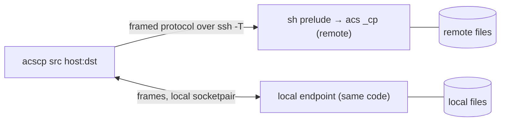
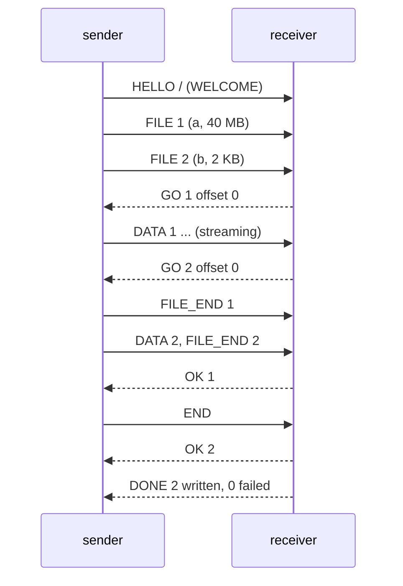
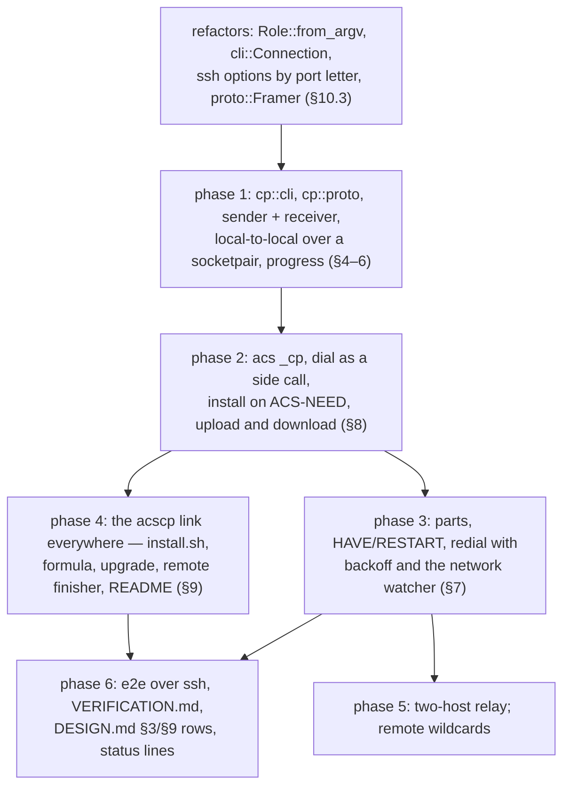

# acscp — design

**Status:** Proposed — nothing built yet. The implementation plan is §12;
the decisions are §13.

`acscp` is to `acs` what `scp` is to `ssh`: it copies files and directories
to and from a host, and between two hosts. It is **not a second program**.
It is the `acs` binary under a second name, running a fourth role, so it
inherits everything the session client already has — host aliases, the ssh
options, the ssh master acs owns, self-installation of the remote end — and
is distributed by the same release, the same installer, the same Homebrew
formula and the same remote install, with no new artifact anywhere. What it
adds over `scp` is what acs adds over `ssh`: a copy that **survives a
network drop** and carries on from where it stopped, and a remote end that
needs nothing but acs — no `sftp-server`, no remote shell expansion of the
path.

The session design this builds on is [DESIGN.md](DESIGN.md); section
references of the form "DESIGN §8" point there.

## 1. What exists today

### 1.1 `scp`

```text
scp [-346BCOpqRrsTv] [-c cipher] [-D sftp_server_path] [-F ssh_config]
    [-i identity_file] [-J destination] [-l limit] [-o ssh_option]
    [-P port] [-S program] [-X sftp_option] source ... target
```

- An argument is remote when it has the form `[user@]host:[path]`; `host`
  may be an IPv6 literal in brackets. An empty path means the home
  directory; a relative one is relative to it.
- Since OpenSSH 9.0 it copies over **SFTP**, which needs the
  `sftp-server` subsystem on the remote; `-O` falls back to the legacy
  protocol, which runs `scp -t`/`scp -f` on the remote through the login
  shell and lets the remote shell expand the path (the source of a long
  line of quoting bugs, and of CVE-2020-15778).
- Either way the remote end is a program the host must already have, found
  through the login shell's `PATH`.
- `-r` recurses and follows symlinks, `-p` preserves times and modes, `-q`
  silences the progress meter, `-3` routes a host-to-host copy through the
  local machine, `-l` limits bandwidth, `-C` asks ssh to compress.
- A dropped connection ends the copy with a partial file at the destination
  under its final name; the next `scp` starts the file over.
- CVE-2019-6111: the legacy receiver wrote whatever file names the remote
  sent into the target directory, so a hostile server could overwrite
  `.bashrc` in answer to a request for `notes.txt`. Modern `scp` checks the
  names it receives against the ones it asked for (`-T` turns that off).

### 1.2 What acs already has that a copy needs

| Need | acs has it as |
| --- | --- |
| Reach a host under a short name, on the right network, with the right key | host aliases, `identity_file`, `prefer`, `local_networks` (DESIGN §7.3) |
| ssh options, verbatim | `-i -p -J -F -o` passthrough, placed after acs's own (DESIGN §7.1) |
| A second connection without a second handshake or key touch | the ssh master acs owns, `Call::Side` (DESIGN §7.1, decision 10) |
| A remote end that is always the client's own version, installed if missing | the prelude, `ACS-NEED`, `install.rs`, the payload set (DESIGN §8) |
| Notice a dead link in seconds and redial with backoff, at once on a network change | `reconnect::Liveness`, `reconnect::Backoff`, `netwatch` (DESIGN §5.3) |
| Framed, 8-bit clean transport over `ssh -T`, with login noise skipped | `proto::Decoder`, `MarkerScanner`, `ACS-READY` (DESIGN §3, §5.1) |
| Print a name the remote chose without it taking the terminal over | `safe::display` (DESIGN §5.1) |
| A digest with no crate | `sha256.rs` |

## 2. Goals and non-goals

### Goals

1. **`scp`'s job, `scp`'s spelling.** `acscp [options] src... dst` with
   `[user@]host:path` arguments, `-r`, `-p`, `-q`, `-v`, `-P`, `-i`, `-J`,
   `-F`, `-o`, `-C`, `-4`, `-6`, a progress meter on a terminal, and the
   same placement rules for the target (§4, §6). A shell alias
   `scp=acscp` should not surprise anyone for the everyday cases.
2. **One binary, no new artifact.** `acscp` is a name of the `acs` binary;
   releases, the installer, Homebrew and `acs upgrade` change only to make
   the name exist (§9). The remote end is `acs _cp`, reached through the
   same prelude and installed by the same self-install (§8).
3. **Reuse, not a parallel client.** The dial, the handshake, the install
   on `ACS-NEED`, alias resolution, the ssh master, the backoff and the
   network watcher are the session client's code, called from the copy
   (§10). The copy adds a protocol layer and the file handling, nothing
   else.
4. **Survive a network drop.** A copy that loses its link redials as a
   session does and continues the file it was on from the bytes the
   receiver already holds, verified (§7). An interrupted copy run again
   resumes the same way.
5. **Nothing on the remote but acs.** No `sftp-server`, no `scp`, no shell
   expansion of a path the user typed: the remote end reads the request
   from a frame and does its own expansion (§8).
6. **Safe against the far end.** The receiver — local or remote — accepts
   only the names it asked for, as single path components, and places a
   file under its final name only when it is whole (§5.4, §6).
7. **Size.** The slim binary stays under 1 MB (DESIGN goal 2); the copy
   role is budgeted at under 100 KB of it.

### Non-goals

- **rsync.** No delta transfer, no `--delete`, no mirroring of a tree
  against another. A whole file is sent, or the tail of one being resumed.
- **A bandwidth limit** (`scp -l`), `-S program`, `-D`, `-X`, `-c cipher`,
  `-O`, `-s`: either meaningless here (there is no sftp and no scp on the
  remote) or not worth their bytes yet. `-l` can come later as a token
  bucket in the poll loop if anyone asks.
- **Preserving hard links, ACLs, xattrs, ownership.** As `scp`.
- **Direct host-to-host copies.** `acscp host1:a host2:b` always goes
  through the local machine, as `scp -3` does (§5.6). The remote-to-remote
  form is also the last phase (§12).
- **Copying into or out of a running session.** `acscp` is its own
  connection; it does not reach into a session's pty.

## 3. Architecture



Two **endpoints** talk the copy protocol (§5). One is a **sender**, which
walks files and streams them; the other a **receiver**, which writes them.
The same two state machines run on either end: in the `acscp` process for
the local side, and in `acs _cp` on the remote. Which end sends depends on
the direction of the copy:

| Copy | Local endpoint | Remote endpoint |
| --- | --- | --- |
| `acscp a b host:d` (upload) | sender | `acs _cp`, receiver |
| `acscp host:a host:b d` (download) | receiver | `acs _cp`, sender |
| `acscp a d` (both local) | sender **and** receiver, over a `socketpair` | — |
| `acscp h1:a h2:d` (two hosts, §5.6) | a relay between the two connections | `acs _cp` sender on `h1`, `acs _cp` receiver on `h2` |

There is **no master and no daemon**: unlike a session, a copy's state that
must outlive a connection is on disk, as the partial file the receiver is
writing (§7). The remote end lives exactly as long as its ssh connection,
like `_proxy`, and the prelude that starts it is the session's prelude with
`_cp` for its argument (§8).

**The role is chosen by the name the binary was run as.** `Role::from_argv`
looks at `argv[0]`'s basename before the first argument: `acscp` is the copy
role, and anything else keeps today's dispatch. `acs cp …` is the same role
spelled without a second name on `PATH`, for a host where only `acs` is
linked, and `cp` joins `list`, `config` and `upgrade` as a reserved first
argument (a host called `cp` is reached as `user@cp`, DESIGN decision 9).
`acscp --version` prints what `acs --version` prints: it is the same file.

**The transport is the session's**, built by `ssh::Transport` from the
same options: `ssh -T -e none -o ServerAliveInterval=0 -o ConnectTimeout=10
<control options> [user@]host sh -c '<prelude> _cp'`. The first connection
is a **side call** (`Call::Side`): it joins or starts the ssh master acs
owns for the host, so `acs devbox`, detach, `acscp build.tar devbox:` costs
one handshake and one key touch in all. A **redial** after a drop is
`Call::Redial`, on a connection of its own, for the reason DESIGN §7.1
gives. The same `LinkEnd` judgement decides whether the lost link takes the
master down with it; a copy sharing a master with a session is a sibling
channel like any other, and a session's redial that ends the master ends
the copy's link too — which the copy then treats as a drop (§7).

## 4. Command line

```text
acscp [-rpqvC46] [-P port] [-i identity_file] [-J destination] [-F config]
      [-o option=value] [--no-reconnect] [--ssh path] [--] source ... target
acs cp ...                        the same, without a second name on PATH
```

| Option | Meaning |
| --- | --- |
| `-r` | copy directories recursively; symlinks are followed, as `scp` does |
| `-p` | preserve modification and access times and the exact mode |
| `-q` | no progress meter, no `acs:` notes short of an error |
| `-v` | ssh commands, remote login noise, connect timings (`timing.rs`), what the alias resolution decided, and one summary line at the end |
| `-P port` | the port — **`-P`, as `scp`**; `-p` is preserve here. `acs` takes ssh's `-p` for the port; the two tools follow their respective originals rather than each other |
| `-i -J -F -o` | passed to every ssh call, verbatim, after acs's own options (DESIGN §7.1) |
| `-C` | `-o Compression=yes`, as `scp -C` |
| `-4` / `-6` | `-o AddressFamily=inet` / `inet6` |
| `--no-reconnect` | end on the first lost link with the partial file kept, as `scp` would (minus the keeping) |
| `--ssh path` | the ssh program (`ACS_SSH`), as `acs` |
| `--transport-cmd` | the test hook `acs` has: run this instead of ssh (DESIGN §9.1) |
| `--` | end of options; a source may begin with `-` |

There is no `-l`, no `-B` (`-o BatchMode=yes` does it), no `-L`: a copy has
no port to forward.

### 4.1 Remote arguments

An argument is **remote** by `scp`'s rule, implemented once in
`cp::cli::split_remote` and tested as a table:

- it contains a `:`, and no `/` before the first `:`; `./a:b` and `/a:b`
  are local, `a:b` is host `a`, path `b`. A leading `:` is a usage error.
- `[user@]` before the host, as everywhere in acs; the user is split by
  `alias::split_user`.
- An IPv6 literal is `[::1]:path`; the brackets are kept for ssh.
- The path after the `:` may be empty (the home directory), relative to the
  home directory, absolute, or `~`-prefixed; `~user/…` is an error rather
  than guessed.

**The host may be an alias** (DESIGN §7.3): it is resolved exactly as the
session resolves one — `client::resolve_alias`, the pings, `prefer`,
`prefer_local_network`, `identity_file`, `user` — and resolved again before
every redial. `-v` says what was chosen, as it does for a session.

**Several remote arguments on one host share one connection** when they
are consecutive sources on the same `[user@]host`: `acscp box:a box:b .`
opens one `acs _cp` and asks it for both. Sources on different hosts, or a
remote source with a remote target, are the relay case (§5.6).

### 4.2 What is checked before any ssh runs

- At least two arguments; the last is the target.
- With more than one source, the target must be a directory (the receiver
  decides; a single file target with several sources is `ERROR` before any
  byte of data, §5.3).
- Every local source exists and is readable, or is reported and skipped
  with the exit status set — `scp` continues past an unreadable source and
  so does this.
- A directory among the sources without `-r` is reported and skipped
  (`scp`: "not a regular file").
- Local-to-local with no remote argument runs the two endpoints in one
  process over a `socketpair` (§3): `scp` copies locally too, and the path
  doubles as the integration tests' transport.

## 5. The copy protocol

### 5.1 Frames

The frames are the session's (DESIGN §5.1): `type u8, len u32 BE, payload`,
split from the byte stream by the same code. The copy has its **own message
set** on top rather than new numbers in the session's `Msg`: a master must
never see a copy frame and a receiver never a session frame, and two enums
make that a type error rather than a runtime check. `proto::Decoder` is
split for this into the frame splitter (`proto::Framer`: bytes in, `(type,
payload)` out, `MAX_FRAME` enforced) that both layers share, and the
`Msg::decode` that today's `Decoder::next_msg` is.

**No protocol version of its own.** `acs _cp` is always the client's own
version — the prelude bakes the version into the path it execs (DESIGN §8)
— so the two ends of a copy are the same build and the message set may
change between releases freely, as `END_SESSION`/`LIST_END` already may.
`ACS-READY <proto version>` still opens the stream, printed by `_cp` as the
proxy prints it, and the client checks it as it does for a session; the
copy's `HELLO` carries the crate version as well, so a `_cp` reached through
an unexpected path refuses a mismatch by name instead of misreading a frame.

### 5.2 Messages

Client → `_cp`, first, before anything else, and written into ssh's stdin
the moment it is spawned exactly as the session's `HELLO` is (DESIGN §3,
acs-trw):

| Message | Payload |
| --- | --- |
| `HELLO` | crate version, the remote end's role (`send` or `receive`), flags `recursive`, `preserve`, `verbose`; for a receiver the target path; for a sender the list of source paths, each as the user typed it after the `:` |

`_cp` answers one of:

| Message | Payload |
| --- | --- |
| `WELCOME` | the remote's `umask`, and whether the target is an existing directory (a receiver) |
| `ERROR` | code, message — e.g. the target is not a directory and several sources were asked for; the connection then ends |

From then on the stream is sender → receiver with a thin control channel
back. **The sender streams; it does not wait per file**, except where the
receiver may have part of the file already (§5.3).

Sender → receiver:

| Message | Payload |
| --- | --- |
| `DIR` | name, mode, mtime — enter a directory; the receiver creates it (or uses an existing one) and makes it the current directory for what follows |
| `DIR_END` | — leave it; `-p` applies the mode and times now, once the contents are in |
| `FILE` | file id `u32`, name, size `u64`, mode, mtime, atime — a regular file begins |
| `DATA` | file id, bytes (at most `proto::MAX_CHUNK`, 32 KiB) |
| `FILE_END` | file id — the sender has sent `size` bytes |
| `SKIP` | name, reason — the sender could not read this entry (gone, unreadable, a special file); for the receiver's report, nothing to write |
| `END` | — the plan is complete |

Receiver → sender:

| Message | Payload |
| --- | --- |
| `GO` | file id, offset — send the file from `offset`; `0` for a new file (§5.3) |
| `OK` | file id — written, renamed into place, times set |
| `FAIL` | file id or name, message — could not be written (permission, disk full, a directory where a file should go); the sender stops sending that file's data and moves on, and the receiver discards what is still in flight for that id |
| `DONE` | files written, files failed — in answer to `END`; the sender exits, the receiver after it |

Both ways: `PING`/`PONG` with a nonce, the session's liveness
(`reconnect::Liveness`, `ACS_DEAD_MS`): a receiver that has gone quiet
because its disk is slow still answers pings, so slowness is not death.

Every string field — a name, a `FAIL` message, a `SKIP` reason — is UTF-8
and bounded as the session's are, and is passed through `safe::display`
before it reaches the terminal (DESIGN §5.1): a file name is a string the
far end chose.

### 5.3 Pipelining and the one round trip that matters

A `FILE` needs the receiver's answer before its data can start, because the
receiver may hold part of it already (§7) and only it knows how much. One
round trip per file is what legacy `scp` paid and SFTP learned to hide; the
copy hides it the same way. The sender **runs headers ahead of data**: it
sends `FILE` for the next entries (up to `ACS_CP_WINDOW`, 64) while it is
still sending `DATA` for the current one, and the receiver answers each
`GO` in order as the headers arrive. By the time the current file's last
chunk goes, the next file's `GO` is waiting, and only the first file of the
copy pays the round trip. A directory full of small files therefore streams
at the link's rate, not at one file per RTT. Directory entries (`DIR`,
`DIR_END`) need no answer and never wait.



Flow control is the pipe's and TCP's: the single-threaded `poll` loop reads
the next chunk from disk only when the transport is writable, so a slow
link never pulls a whole file into memory, and the receiver writes each
chunk as it lands. The control frames going back are small and few, so
they never fill the reverse direction.

### 5.4 Names

The receiver trusts nothing about a name (goal 6, CVE-2019-6111):

- A `name` in `DIR` or `FILE` is **one path component**: non-empty, not `.`
  or `..`, no `/`, no NUL. Anything else is a protocol error and ends the
  copy. Nesting happens only through `DIR`/`DIR_END`, so the receiver's
  current directory is always inside its target.
- At the top level the receiver accepts **only the names it asked for**:
  for a download, the basenames of the requested source paths; for an
  upload, the basenames the local sender announced. A top-level entry with
  any other name is refused with `FAIL` and reported. Once remote wildcards
  exist (§12, phase 5) a request containing one accepts any top-level name
  that matches the pattern, which is the check modern `scp` makes.
- Depth is bounded (`DIR` nesting over 256 is a protocol error), and the
  sender never follows a symlink to a directory into itself more than once
  (it keeps the `(dev, ino)` pairs on its path, as `scp` relies on the
  kernel's `ELOOP` for and `find` does properly).

### 5.5 Ending

`END` is answered with `DONE` once every outstanding file is `OK` or
`FAIL`; the sender exits on `DONE` and the receiver on EOF after it. The
exit status is 0 when every file was written, 1 when any was skipped or
failed (as `scp`), and the session client's distinct codes for the rest:
`exit::UNREACHABLE` (255) when the host could not be reached at all,
`exit::INSTALL_FAILED` (254) when it could not be installed, `exit::USAGE`
(2) for the command line. A Ctrl-C ends the copy at once, with the current
partial file kept for a later resume (§7).

### 5.6 Two remote arguments

`acscp h1:a h2:b` opens an `acs _cp` **sender** on `h1` and an `acs _cp`
**receiver** on `h2`, sends each its `HELLO`, and then **splices the two
connections' frames** in both directions, as `_proxy` splices a session's
(DESIGN §4.3). The local process never touches the file data beyond
passing it through, and reads the `FILE` headers going by only for the
progress meter. Both connections are side calls, each on its host's master
if there is one. A drop on either side ends the copy in this form: the
redial logic (§7) wants an endpoint to resume from, and the local relay is
neither; a user who needs resilience here copies in two steps. Several
remote sources on different hosts into one target are the same relay run
once per source host, in turn.

## 6. Files on disk

`scp`'s placement rules, decided by the **receiver**, which is the end that
can see the target:

| Sources | Target | Result |
| --- | --- | --- |
| one file | an existing directory | the file under its own name inside it |
| one file | anything else | a file of that name (created or replaced) |
| several, or any directory | an existing directory | each under its own name inside it |
| several | not a directory | `ERROR`, before any data |
| one directory (`-r`) | an existing directory | `target/dirname/…` |
| one directory (`-r`) | missing | created as `target`, the contents inside it |

A file is written to a **temporary name beside its final one** and renamed
over it when whole: `.<name>.acscp-part`. Nothing ever sees a half-written
file under the final name — which `scp` does not promise — and the part is
what a resume picks up (§7). Consequences, stated rather than hidden: a
hard link to the old destination is left pointing at the old content, a
destination the user can write but whose directory they cannot create files
in cannot be written, and a replaced file's mode becomes the source's (after
the umask) rather than staying what it was. All three are how `rsync` and
`install` behave and are accepted as the price of atomic placement.

- **Mode**: a new file is created with the source's mode through the
  receiver's umask; `-p` sets it exactly afterwards. Directories are
  created `0700 | mode` so their contents can be written, and get their
  final mode at `DIR_END` (`-p`) or keep the umask'd one.
- **Times**: `-p` sets `mtime` and `atime` (`utimensat`) after the rename
  for files and at `DIR_END` for directories, so the contents' writes do
  not disturb them.
- **Symlinks** are followed on the sending side and sent as what they point
  at, as `scp` does; a dangling one is a `SKIP`.
- **Special files** (devices, sockets, fifos) are a `SKIP` with a reason.
- **A source that changes size while it is read**: the sender sends exactly
  `size` bytes as announced — short, padded with nothing, so a file that
  grew is cut and one that shrank is a `FAIL` ("file changed while being
  read") rather than a silently wrong copy.
- **Disk full** on the receiver is a `FAIL` naming the file; the part is
  removed, since there is nothing to resume into.

## 7. Resume and reconnect

The reason to have this at all. A copy loses its link for the same reasons
a session does — Wi-Fi roaming, a laptop lid, a VPN flap — and `scp`
answers with a partial file under the final name and a restart from zero.

**On the wire nothing is remembered; on disk the part is.** When the link
drops, the sender knows which files were `OK`'d, and the receiver has a
`.<name>.acscp-part` for the file in flight. The redial is the session's
(`reconnect::Backoff`, 1 s doubling to 30 s, reset by a connection that
lasted; `netwatch` cutting the wait short when this machine's own network
changes; the alias resolved again before each attempt, DESIGN §5.3), with a
status line on stderr instead of over the terminal, since nothing of the
copy's is on the terminal to protect. On a new connection the client sends
a new `HELLO` and the sender **replans from the first file that was not
`OK`'d**: files already in place are not sent again within one run.

For a `FILE` whose part exists, the receiver answers not `GO 0` but:

| Message | Payload |
| --- | --- |
| `HAVE` | file id, length of the part, SHA-256 of the part |

The sender hashes the same prefix of its source. Equal: it sends `DATA`
from that offset and the receiver appends. Different — the source changed,
or the part is from another file of the same name — the sender sends
`RESTART` (file id) and then `DATA` from 0, and the receiver truncates the
part first. Both hashes are of the bytes actually on disk, so a part cut
mid-write by a crash resumes from what reached the disk. The cost is one
read of the part on each side at disk speed: ten seconds for a few GB on a
laptop, against sending them again over the link that just failed. The
hashing runs in slices inside the poll loop, a megabyte per turn, so pings
are still answered while it goes (§5.2).

**An interrupted run resumed by a later run** is the same mechanism with
no extra state: a Ctrl-C, a `--no-reconnect` ending, a laptop that died —
whatever left a part behind — is picked up by the next `acscp` of the same
file into the same place, because the receiver answers `HAVE` whenever a
part is there. Nothing records which run made it; the hash is the
authority. A part that no later run claims stays where it is, visibly
named, and is removed by hand. `acscp` never deletes one it did not just
finish or just fail.

**What is not resumed**: a two-host relay (§5.6), and a file the sender
cannot re-read (gone or changed) — reported as `FAIL`, the copy continues
with the rest.

## 8. The remote end: `acs _cp`

The remote command is `ssh::remote_acs(VERSION, &["_cp"])` — the session's
prelude with a different argument, so everything DESIGN §8 says holds
unchanged: the per-version path, the ownership and mode check before the
`exec` (acs-08m, acs-gov, acs-6w9), `ACS-NEED <os> <arch>` when the binary
is missing, and the client's reaction to it: `install::plan`, the two-step
upload with the shell checking the digest, `_install --finish`, then the
dial again. `install_on_remote: false` refuses with the same message
(`install::not_installing`), and a host set up with `install.sh` or
Homebrew serves copies as it serves sessions. **The first `acscp` to a
fresh host installs acs there**, and from then on `acs` works too.

`acs _cp` itself:

- prints `ACS-READY <proto version>` first and reads nothing before it, so
  the client's `HELLO` can be in the pipe already (DESIGN §3, acs-trw),
- takes **no arguments beyond `_cp`**: the paths arrive in the `HELLO`
  frame, never on the command line. There is no quoting problem to get
  right because nothing goes through a shell after the prelude, and the
  prelude's own argument is a constant,
- expands `~` and resolves a relative path against `$HOME` (sshd starts it
  there; the `HELLO`'s empty path is `.`),
- runs the sender or receiver state machine over its stdin and stdout, the
  very code the local end runs,
- touches its version directory on start, as `_proxy` does, so a host that
  is only ever copied to is not pruned out from under the next copy
  (`prune::on_proxy_start`, DESIGN §8), and
- writes nothing to stdout but frames after the marker, and to stderr only
  a fatal error, which ssh carries to the user's terminal.

It never looks at the session directory, the socket directory or the
masters: a copy and a session on the same host share only the binary and,
on the client side, the ssh master.

## 9. Distribution: the name, and nothing else

`acscp` must be found wherever `acs` is found, and must be the same file,
so one upgrade moves both. Every place acs is put therefore also links the
name. The release archives (`acs-<version>-<target>.tar.gz`), the payload
set, `SHA256SUMS`, its signature, `cargo xtask dist`, `scripts/version-bump.sh`
and `scripts/release-binaries.sh` **do not change**: there is no acscp
artifact to build, sign or publish.

| Where acs is installed | What links `acscp` | By |
| --- | --- | --- |
| `~/.local/share/acs/<v>/acs`, linked from `~/.local/bin/acs` | `~/.local/bin/acscp -> acs` (relative, same directory) | `scripts/install.sh`, after its `link` of `acs` |
| `/usr/local/lib/acs/<v>/acs`, linked from `/usr/local/bin/acs` (as root) | `/usr/local/bin/acscp -> acs` | `scripts/install.sh` |
| `ACS_INSTALL_DIR/acs` | `ACS_INSTALL_DIR/acscp -> acs` | `scripts/install.sh` |
| Homebrew keg | `bin.install_symlink bin/"acs" => "acscp"` | `cargo xtask formula` (`xtask/src/formula.rs`); `brew test` runs `acscp --version` too |
| a remote installed on first contact | `~/.local/bin/acscp -> acs`, beside the `~/.local/bin/acs` link | `install::finish` (`link_bin`'s companion), so the host can be the client for the next hop, for copies too |
| replaced by `acs upgrade` | the relative link already points at the new `acs`; one that is missing (an install older than this design) is made | `upgrade.rs`, the same companion function |
| by hand, from the archive | `ln -s acs ~/.local/bin/acscp` | README "Install", the release notes' by-hand snippet (`xtask/src/package.rs`) |

**Relative, and only ever our own.** The link is `acscp -> acs`, not
`acscp -> ~/.local/share/acs/<v>/acs`: pointing at the name beside it means
an `acs upgrade`, an `install.sh` re-run or a remote install of a newer
version repoints `acs` and `acscp` follows for free. It is created when the
path is empty, or when it is a symlink whose target is the bare name `acs`
(ours); a file or any other link the user put there is left alone, exactly
`should_link`'s rule for `acs`. Failing to make it is a warning, never a
failed install: nothing in the protocol depends on it, and `acs cp` is the
spelling that needs no link.

**Why not a second `[[bin]]`.** A second executable in the archive would
be a second 0.5–1.2 MB file per target — the payload set would either be
carried twice or `acscp` would be unable to install a remote — a second
file for `install.sh`, the formula, `acs upgrade` and the remote finisher to
place and check, and a second name in `SHA256SUMS`. A link is zero bytes
and nothing new to verify. The busybox convention of dispatching on
`argv[0]` costs one function.

The release notes and README gain `acscp` lines; `docs/VERSIONING.md`
needs no change, since the formula's generator is already the single place
the formula is defined and the tap update is unchanged.

## 10. Implementation

### 10.1 What is reused, as it is

| Need | Module and item |
| --- | --- |
| ssh argv, control options, the master, quoting, the prelude | `ssh::Transport`, `ssh::Call::{Side, Redial}`, `ssh::remote_acs`, `mux::configure`, `mux::joinable`, `mux::stop` |
| spawn ssh, write the greeting early, wait for the marker, the master's fast-fail window | `client::dial`, `client::answer_timeout`, `client::Link` |
| install on `ACS-NEED` | `install::plan`, `install::install`, `install::not_installing`, `payload::*`, `sha256::*` |
| host aliases and their pings, keys and ranking | `client::resolve_alias`, `alias::*`, `netmatch::*`, `config::Config::load` |
| backoff, liveness, network-change redial | `reconnect::Backoff`, `reconnect::Liveness`, `netwatch::NetWatch` |
| frame splitting and the markers | `proto::Framer` (split out of `Decoder`, §5.1), `proto::MarkerScanner`, `proto::ready_line`, `MAX_FRAME`, `MAX_CHUNK` |
| notes, exit codes, timings, safe display, durations | `client::note`, `client::exit`, `timing::Timing`, `safe::display`, `list::span` |
| the weekly update check | `update_check::on_client_start` |
| libc: `poll`, `isatty`, non-blocking fds, window size for the meter | `sys::*` |
| prune the version directory's clock | `prune::on_proxy_start` |

### 10.2 What is new

```text
src/
  cp/
    mod.rs        acscp entry: parse, plan, dial per host, relay or endpoint
    cli.rs        scp-compatible arguments; split_remote; the usage text
    proto.rs      the copy messages (§5.2) over proto::Framer
    sender.rs     walk sources, run headers ahead, stream DATA, hash on HAVE
    receiver.rs   place files (§6), parts and HAVE (§7), name checks (§5.4)
    walk.rs       the local tree: entries, metadata, symlink and loop rules
    progress.rs   the stderr meter: name, percent, size, rate, ETA
    remote.rs     acs _cp: marker, HELLO, pick the endpoint, run it on stdio
    relay.rs      two-host copies: splice two links, peek headers (§5.6)
```

The sender and the receiver are each a state machine driven by a loop that
`poll`s the transport's two fds, the files, and the self-pipe for signals
— the shape every other loop in acs has. Local-to-local runs both in one
process over a `socketpair`, one per side of the loop; this is also how
`tests/` exercise the protocol with no transport at all.

### 10.3 Refactors the reuse asks for

Small, and each one is a change the session code is better for:

1. **`Role::from_argv(&args)`** in `lib.rs`, consulting `argv[0]`'s
   basename for `acscp` before falling through to today's
   `from_first_arg`; `cp` added to the reserved first arguments.
2. **`cli::Connection`**: the part of `ClientArgs` that is about reaching a
   host — `transport`, `verbose`, `config`, `alias`, `entry` — split out so
   `client::dial`, `client::resolve_alias`, `install::install` and
   `install::not_installing` take a `&Connection` rather than a
   `&ClientArgs`. `ClientArgs` embeds one; `cp::cli::CopyArgs` embeds one
   per host. No behaviour changes.
3. **The ssh option passthrough** in `cli.rs` becomes a function that takes
   the letter the port option is spelled with (`p` for `acs`, `P` for
   `acscp`), so the list of passed-through options and their validation
   stay in one place.
4. **`proto::Framer`** split out of `proto::Decoder` (§5.1), with
   `Decoder` becoming `Framer` plus `Msg::decode`. The frame tests apply
   to both unchanged.
5. **`install::link_bin`** grows a companion that makes the relative
   `acscp` link, shared with `upgrade.rs` (§9).
6. **`reconnect::run`** is the session's whole offline wait, status line
   included; the copy uses `Backoff`, `Liveness` and `NetWatch` directly
   with a loop of its own, because it has no terminal state and no command
   keys. If the two loops turn out alike, the common part is lifted then,
   not guessed now.

### 10.4 Size

The copy role is argument parsing, two state machines, a file walker and a
progress line, all on `std` and the existing `sys` wrappers, with no new
dependency. The budget is 100 KB of the stripped binary (goal 7), measured
as the difference in `cargo xtask dist`'s size table (DESIGN §8.1) before
and after phase 2, and recorded there.

## 11. Testing

- **Unit** (`src/cp/*`): `split_remote` as a table — `host:p`, `u@host:p`,
  `[::1]:p`, `./a:b`, `/a:b`, `host:`, `:p` (error), `~`; option parsing
  including `-P` against `-p` and `--`; name validation as a table (`..`,
  `a/b`, empty, NUL, a 300-byte name, UTF-8); the message codec
  round-trips and truncation, as the session's; the placement table of
  §6 against a scratch directory; `HAVE`/`RESTART` with a matching and a
  mismatching part.
- **Integration, no transport** (`tests/cp_local.rs`): local-to-local
  over the `socketpair` — a tree of files of sizes 0, 1, 32 KiB − 1, 32 KiB,
  32 KiB + 1 and 5 MB, a nested directory with `-r`, `-p` times and modes,
  a symlink to a file, a dangling symlink, a fifo, an unreadable file;
  asserted as **byte-for-byte equality of the two trees** plus the exit
  status and the report.
- **Integration, fake remote** (`tests/cp_remote.rs`, `--transport-cmd`
  with `tests/common::Remote`, which already stands in for a host with and
  without acs installed): upload, download, several sources on one host;
  first contact installs acs (the `ACS-NEED` path) and the copy then
  proceeds; `install_on_remote: false` refuses with the message; the
  transport killed mid-file and the copy resumed — the trees equal and the
  resumed file's part reused rather than rewritten (asserted by the bytes
  the second connection carried); a part with a wrong prefix restarted;
  Ctrl-C leaves the part and a second run finishes from it; a receiver
  that sends a name with `/` or `..`, or a top-level name not asked for, is
  refused; a top-level `.bashrc` in answer to `host:notes.txt` is refused.
- **Pipelining**: a hundred 1-byte files over a transport the harness
  delays by 50 ms each way finish in well under a hundred round trips.
- **Linux** (`scripts/test_linux.sh`): the suite as root with `alice` and
  `bob` — a copy into another user's directory fails as it should, and the
  per-version install and prune touch work for copies.
- **End to end** (`scripts/e2e_ssh.sh`): first contact from `acscp` on a
  fresh container host installs acs; upload and download of a tree with
  `-r -p` compared with `diff -r`; `sshd-session` killed mid-copy of a
  200 MB file and the copy completing, with the part visibly reused; the
  copy joining the session's master (`-v` shows no second handshake;
  `ssh -O check` shows one pid); `acscp` and `acs cp` both present after
  the install; `acs _cp`'s version directory touched.
- **Installer** (`scripts/test_install.sh`): `acscp --version` works
  after each layout — default, pinned, re-run, `ACS_INSTALL_DIR`, root —
  and the link is relative. (The suite is stale today, acs-t8t; the new
  checks go in with its repair or after it.)
- **Homebrew**: `brew test` runs `acscp --version`; `brew audit --strict`
  on the generated formula.
- **By hand**: a 2 GB copy over Wi-Fi with the laptop lid closed for a
  minute halfway, and `scp`'s `-r` of the same tree for a timing
  comparison, recorded in [VERIFICATION.md](VERIFICATION.md).

## 12. Implementation plan

To be filed as beads under an epic **"acscp: scp for acs"**, each with its
section references; the order is the dependency order.



- **Phase 1** is usable on its own as a test bed and is where the protocol
  is proven: everything in §11's first two bullets passes before any ssh is
  involved.
- **Phase 2** is the first thing a user runs: `acscp file host:` to a host
  that has never seen acs. It ships behind no flag — until phase 3 a drop
  ends the copy with the part kept, which is already no worse than `scp`.
- **Phase 3** makes it an acs tool. Phase 4 can land in parallel with it,
  since it touches only the installers.
- **Phase 5** is optional and last: the relay (§5.6) and remote wildcards
  (§5.4), each a bead of its own, taken when someone misses them.
- **Phase 6** closes the loop the way DESIGN §8.1 and VERSIONING.md ask:
  the `Status:` line here, a row in DESIGN §3's role table and §9's
  layout, README "Use", and the end-to-end results.

## 13. Decisions

| # | Question | Decision |
| --- | --- | --- |
| 1 | A program or a name | A name of the `acs` binary, dispatched on `argv[0]`, with `acs cp` as the spelling that needs no link (§3). No second `[[bin]]`: it would double the artifacts and either double the payloads or leave `acscp` unable to install a remote (§9) |
| 2 | The remote end | A fourth role, `acs _cp`, per connection, no daemon; the state that must outlive a connection is the part file on disk (§3, §7). Started by the session's prelude, so it is always the client's version and is installed by the existing self-install (§8) |
| 3 | `-p` | `scp`'s: preserve. The port is `-P`. Each tool follows its original; an alias `scp=acscp` must not change what `-p` means (§4) |
| 4 | Paths to the remote | In the `HELLO` frame, never on the command line: no shell after the prelude, no quoting, no remote expansion the user did not ask for (§8). `~` and relative paths are expanded by `_cp` itself |
| 5 | Placement | `scp`'s rules, decided by the receiver (§6). Files are written to `.<name>.acscp-part` and renamed into place when whole, accepting what atomic placement costs — a hard link not followed, a replaced file's mode reset (§6) |
| 6 | Resume | By the part on disk and a hash of its prefix on both sides (`HAVE`/`RESTART`), no run state anywhere else, so a later run resumes an earlier one by the same mechanism as a redial does (§7). The hash costs a read at disk speed and buys never trusting a size alone |
| 7 | Per-file round trip | Headers run ahead of data by a window of 64, so only the first file pays it (§5.3). A simpler one-file-at-a-time protocol was rejected for the small-files case, which is most of what people copy |
| 8 | Names from the far end | Single components only, nesting only by `DIR`/`DIR_END`, top-level names must be the ones requested (§5.4) — the lessons of CVE-2019-6111, applied on both ends since the local side is a receiver on a download |
| 9 | Which ssh calls | First connection a side call on acs's master, redials on their own connection — the session's rule and the session's reasons (§3). A copy is a sibling channel of a session on the same master and is ended with it when a session's redial ends the master; it redials and resumes |
| 10 | Two hosts | Through the local machine, as `scp -3`, by splicing frames with no file handling in the middle; no resume in that form; last phase (§5.6, §12) |
| 11 | Message set | Its own enum over the shared frame splitter rather than new numbers in the session's `Msg`, so the type system keeps the two apart; no protocol version of its own, since both ends are always the same build (§5.1) |
| 12 | Liveness | The session's pings, with the receiver's hashing sliced inside the poll loop so a long `HAVE` cannot look like a dead link (§5.2, §7) |
