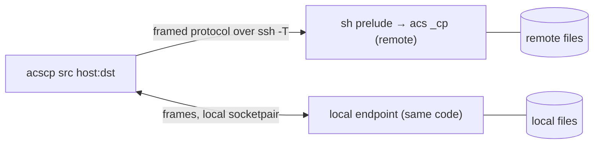
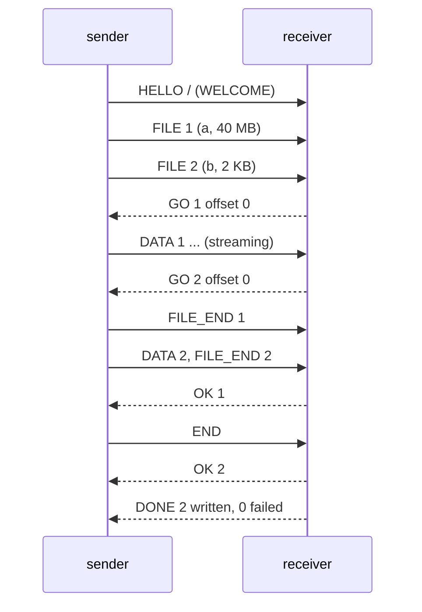
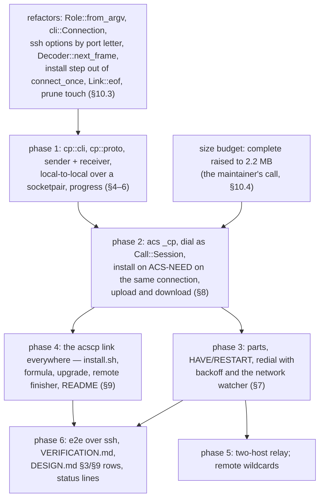

# acscp — design

**Status:** Built (phases 1–6, PRs #393–#423, epic
acs-hofu); by-hand checks still to do: a 2 GB copy over Wi-Fi with the
lid closed a minute halfway, and an `scp -r` timing comparison, acs-hofu.15
([VERIFICATION.md](VERIFICATION.md)). The implementation plan, with what
landed where, is §12; the decisions are §13, and the ones taken while
building are DESIGN §12 decisions 13–17.

Written 2026-10-27 against main at 9399428; revised against main at
9c67b7a on 2026-10-28, so that every claim about the existing code holds
there (what changed is listed under §13's revisions); brought up to date
with what was built on 2026-10-28, against main at 3ea4253. Where the
build departs from the draft, the text says so in an **As built** note.

`acscp` is to `acs` what `scp` is to `ssh`: it copies files and directories
to and from a host, and between two hosts. It is **not a second program**.
It is the `acs` binary under a second name, running a fourth role, so it
inherits everything the session client already has — host aliases, the ssh
options, the ssh master acs owns, self-installation of the remote end — and
is distributed by the same release, the same installer, the same Homebrew
formula and the same remote install, with no new artifact anywhere. What it
adds over `scp` is what acs adds over `ssh`: a copy that **survives a
network drop** and carries on from where it stopped, and a remote end that
needs nothing but acs — no `sftp-server`, no remote shell expansion of the
path.

The session design this builds on is [DESIGN.md](DESIGN.md); section
references of the form "DESIGN §8" point there.

## 1. What exists today

### 1.1 `scp`

```text
scp [-346BCOpqRrsTv] [-c cipher] [-D sftp_server_path] [-F ssh_config]
    [-i identity_file] [-J destination] [-l limit] [-o ssh_option]
    [-P port] [-S program] [-X sftp_option] source ... target
```

- An argument is remote when it has the form `[user@]host:[path]`; `host`
  may be an IPv6 literal in brackets. An empty path means the home
  directory; a relative one is relative to it.
- Since OpenSSH 9.0 it copies over **SFTP**, which needs the
  `sftp-server` subsystem on the remote; `-O` falls back to the legacy
  protocol, which runs `scp -t`/`scp -f` on the remote through the login
  shell and lets the remote shell expand the path (the source of a long
  line of quoting bugs, and of CVE-2020-15778).
- Either way the remote end is a program the host must already have, found
  through the login shell's `PATH`.
- `-r` recurses and follows symlinks, `-p` preserves times and modes, `-q`
  silences the progress meter, `-3` routes a host-to-host copy through the
  local machine, `-l` limits bandwidth, `-C` asks ssh to compress.
- A dropped connection ends the copy with a partial file at the destination
  under its final name; the next `scp` starts the file over.
- CVE-2019-6111: the legacy receiver wrote whatever file names the remote
  sent into the target directory, so a hostile server could overwrite
  `.bashrc` in answer to a request for `notes.txt`. Modern `scp` checks the
  names it receives against the ones it asked for (`-T` turns that off).

### 1.2 What acs already has that a copy needs

| Need | acs has it as |
| --- | --- |
| Reach a host under a short name, on the right network, with the right key | host aliases, `identity_file`, `prefer`, `local_networks`, the entry used last on these networks (`alias_memory.rs`, acs-zpj) (DESIGN §7.3) |
| ssh options, verbatim | `-i -p -J -F -o` into `Transport::user_opts`, placed after acs's own (DESIGN §7.1) |
| A second connection without a second handshake or key touch | the ssh master acs owns, joined or started by a `Call::Session` dial (`mux.rs`; DESIGN §3, §7.1, decision 10) |
| A remote end that is always the client's own version, installed if missing | the prelude, `ACS-NEED`, and the install **on the same connection**: `ssh::prelude_installing`, `ACS-INSTALL <sync>`, `install::install`, the payload set (DESIGN §8, §8.1, acs-6k2) |
| Notice a dead link in seconds and redial with backoff, at once on a network change | `reconnect::Liveness`, `reconnect::Backoff`, `netwatch::NetWatch`, and a dial that a lost network abandons (`client::dial_watching`, acs-xo1) (DESIGN §5.3) |
| Tell a dead connection from an ended channel | `client::LinkEnd`, `Link::eof` reading ssh's exit status (acs-b4f, DESIGN §7.1) |
| Framed, 8-bit clean transport over `ssh -T`, with login noise skipped | `proto::Decoder`, `MarkerScanner`, `ACS-READY` (DESIGN §3, §5.1) |
| Write a frame stream to a slow peer without copying it around | `outq::OutQueue`, `proto::encode_data` (acs-m08z, acs-8uxk) |
| Print a name the remote chose without it taking the terminal over | `safe::display` (DESIGN §5.1) |
| A digest with no crate | `sha256.rs`: `Sha256` (incremental), `digest`, `file`, `copy_file` |
| Create, replace and link files without following what someone planted | `sys::create_new_mode`, `sys::write_atomic`, `sys::symlink_atomic` (acs-721, acs-g4uc) |
| The install layout, spelled once | `layout.rs` (`USER_BIN`, `SYSTEM_BIN`, …), held to `install.sh` by `tests/scripts.rs` |

## 2. Goals and non-goals

### Goals

1. **`scp`'s job, `scp`'s spelling.** `acscp [options] src... dst` with
   `[user@]host:path` arguments, `-r`, `-p`, `-q`, `-v`, `-P`, `-i`, `-J`,
   `-F`, `-o`, `-C`, `-4`, `-6`, a progress meter on a terminal, and the
   same placement rules for the target (§4, §6). A shell alias
   `scp=acscp` should not surprise anyone for the everyday cases.
2. **One binary, no new artifact.** `acscp` is a name of the `acs` binary;
   releases, the installer, Homebrew and `acs upgrade` change only to make
   the name exist (§9). The remote end is `acs _cp`, reached through the
   same prelude and installed as a session's remote is, on the same
   connection (§8).
3. **Reuse, not a parallel client.** The dial, the handshake, the install
   on `ACS-NEED`, alias resolution, the ssh master, the backoff and the
   network watcher are the session client's code, called from the copy
   (§10). The copy adds a protocol layer and the file handling, nothing
   else.
4. **Survive a network drop.** A copy that loses its link redials as a
   session does and continues the file it was on from the bytes the
   receiver already holds, verified (§7). An interrupted copy run again
   resumes the same way.
5. **Nothing on the remote but acs.** No `sftp-server`, no `scp`, no shell
   expansion of a path the user typed: the remote end reads the request
   from a frame and does its own expansion (§8).
6. **Safe against the far end.** The receiver — local or remote — accepts
   only the names it asked for, as single path components, and places a
   file under its final name only when it is whole (§5.4, §6).
7. **Size.** The binary stays inside DESIGN goal 2's budget — slim
   ≤ 1.15 MB, complete ≤ 2.3 MB, as `cargo xtask dist` enforces it, raised
   from 1.1 MB / 2.1 MB to make room for the copy (#401, acs-hofu.9) — and
   the copy role is budgeted at **100 KB of the slim x86_64 Linux build**
   (decision 13, set by the maintainer; it was 50 KB). As built it
   measures 87,776 B there (§10.4).

### Non-goals

- **rsync.** No delta transfer, no `--delete`, no mirroring of a tree
  against another. A whole file is sent, or the tail of one being resumed.
- **A bandwidth limit** (`scp -l`), `-S program`, `-D`, `-X`, `-c cipher`,
  `-O`, `-s`: either meaningless here (there is no sftp and no scp on the
  remote) or not worth their bytes yet. `-l` can come later as a token
  bucket in the poll loop if anyone asks.
- **Preserving hard links, ACLs, xattrs, ownership.** As `scp`.
- **Direct host-to-host copies.** `acscp host1:a host2:b` always goes
  through the local machine, as `scp -3` does (§5.6, built in phase 5).
- **Copying into or out of a running session.** `acscp` is its own
  connection; it does not reach into a session's pty.

## 3. Architecture



Two **endpoints** talk the copy protocol (§5). One is a **sender**, which
walks files and streams them; the other a **receiver**, which writes them.
The same two state machines run on either end: in the `acscp` process for
the local side, and in `acs _cp` on the remote. Which end sends depends on
the direction of the copy:

| Copy | Local endpoint | Remote endpoint |
| --- | --- | --- |
| `acscp a b host:d` (upload) | sender | `acs _cp`, receiver |
| `acscp host:a host:b d` (download) | receiver | `acs _cp`, sender |
| `acscp a d` (both local) | sender **and** receiver, over a `socketpair` | — |
| `acscp h1:a h2:d` (two hosts, §5.6) | a relay between the two connections | `acs _cp` sender on `h1`, `acs _cp` receiver on `h2` |

There is **no master and no daemon**: unlike a session, a copy's state that
must outlive a connection is on disk, as the partial file the receiver is
writing (§7). The remote end lives exactly as long as its ssh connection,
like `_proxy`, and the prelude that starts it is the session's prelude with
`_cp` for its argument (§8).

**The role is chosen by the name the binary was run as.** Today
`lib::run` dispatches on the first argument alone
(`Role::from_first_arg(args.get(1))`); `Role::from_argv` (§10.3) looks at
`argv[0]`'s basename as well: `acscp` is the copy role, and anything else
keeps today's dispatch. An underscore-prefixed first argument still selects
its hidden role whatever `argv[0]` is, so a re-exec of this binary through
a path that happens to be named `acscp` cannot land in the copy role.
`acs cp …` is the same role spelled without a second name on `PATH`, for a
host where only `acs` is linked, and `cp` joins `list`, `config` and
`upgrade` as a reserved first argument (a host called `cp` is reached as
`user@cp`, DESIGN decision 9). The remote end is a hidden role of its
own, `_cp`, dispatched as `_proxy` and `_master` are.
`acscp --version` prints what `acs --version` prints: it is the same file.

**The transport is the session's**, built by `ssh::Transport` from the
same options: `ssh -T -e none -o ServerAliveInterval=0 -o ConnectTimeout=10
<control options> [user@]host sh -c '<prelude> _cp'`. Those fixed options
are `ssh::TRANSPORT_OPTS`, which only the session's own calls carry, so the
first connection is a **`Call::Session`** — not a `Call::Side`, whose
`SIDE_OPTS` set neither `ServerAliveInterval=0` nor `ConnectTimeout=10` and
which, with no master, leaves the user's own multiplexing in place instead
of opting out of it. `Call::Session` joins or starts the ssh master acs owns
for the host, so `acs devbox`, detach, `acscp build.tar devbox:` costs one
handshake and one key touch in all; the `-L` forwards it would carry are
empty, because a copy has none (§4.1). A **redial** after a drop is
`Call::Redial`, on a connection of its own, for the reason DESIGN §7.1
gives. The same `LinkEnd` judgement decides whether the lost link takes the
master down with it (`LinkEnd::failed_the_connection`, acs-n1m, with EOF on
a channel split by ssh's exit status, acs-b4f); a copy sharing a master
with a session is a sibling channel like any other, and a session's redial
that ends the master ends the copy's link too — which the copy then treats
as a drop (§7).

## 4. Command line

```text
acscp [-rpqvC46] [-P port] [-i identity_file] [-J destination] [-F config]
      [-o option=value] [--no-reconnect] [--ssh path] [--] source ... target
acs cp ...                        the same, without a second name on PATH
```

| Option | Meaning |
| --- | --- |
| `-r` | copy directories recursively; symlinks are followed, as `scp` does |
| `-p` | preserve modification and access times and the exact mode |
| `-q` | no progress meter, no `acs:` notes short of an error |
| `-v` | ssh commands, remote login noise, connect timings (`timing.rs`, the session's `timing::Phase` list — the copy adds no phase, §10.1), what the alias resolution decided, and one summary line at the end |
| `-P port` | the port — **`-P`, as `scp`**; `-p` is preserve here. `acs` takes ssh's `-p` for the port; the two tools follow their respective originals rather than each other. It goes into `user_opts` as ssh's `-p`, so `reachability_tcp`'s `ssh -G` sees it too (acs-nhrq) |
| `-i -J -F -o` | passed to every ssh call, verbatim, after acs's own options (DESIGN §7.1) |
| `-C` | `-o Compression=yes`, as `scp -C` |
| `-4` / `-6` | `-o AddressFamily=inet` / `inet6` |
| `--no-reconnect` | end on the first lost link with the partial file kept, as `scp` would (minus the keeping) |
| `--ssh path` | the ssh program (`ACS_SSH`), as `acs` |
| `--transport-cmd` | the test hook `acs` has: run this instead of ssh (DESIGN §9.1) |
| `--` | end of options; a source may begin with `-` |

There is no `-l`, no `-B` (`-o BatchMode=yes` does it), no `-L`: a copy has
no port to forward.

### 4.1 Remote arguments

An argument is **remote** by `scp`'s rule, implemented once in
`cp::cli::split_remote` and tested as a table:

- it contains a `:`, and no `/` before the first `:`; `./a:b` and `/a:b`
  are local, `a:b` is host `a`, path `b`. A leading `:` is a usage error.
- `[user@]` before the host, as everywhere in acs; the user is split by
  `alias::split_user`.
- An IPv6 literal is `[::1]:path`; the brackets are kept for ssh.
- The path after the `:` may be empty (the home directory), relative to the
  home directory, absolute, or `~`-prefixed; `~user/…` is an error rather
  than guessed.

**The host may be an alias** (DESIGN §7.3): it is resolved exactly as the
session resolves one — `client::resolve_alias`, the pings,
`reachability_tcp`, `prefer`, `prefer_local_network`, the entry remembered
for these networks (acs-zpj), `identity_file`, `user` — and resolved again
before every redial. `-v` says what was chosen, as it does for a session.
The configuration's `local_forwards` are **not** applied
(`client::prepare_session` is the session's, not the copy's): a copy
forwards nothing, and a forward would cost it the shared master (acs-9n3).
The copy calls `mux::configure` itself, before its first dial, as
`prepare_session` does.

**Several remote arguments on one host share one connection** when they
are consecutive sources on the same `[user@]host`: `acscp box:a box:b .`
opens one `acs _cp` and asks it for both. Sources on different hosts, or a
remote source with a remote target, are the relay case (§5.6).

**As built:** sources need not all be on one side. Local and remote
sources together, and downloads from several hosts, run **in parts** —
each source host's group first, in the order the command line names them
(a download into a local target, a relay into a remote one), then the
local sources (a local copy or one upload) — with one summed report and
exit status; a part that breaks off ends the copy (DESIGN §12 decision
17). Several sources in all, or a wildcard, need a directory target,
decided once over the whole command line.

### 4.2 What is checked before any ssh runs

- At least two arguments; the last is the target.
- With more than one source, the target must be a directory (the receiver
  decides; a single file target with several sources is `ERROR` before any
  byte of data, §5.3).
- Every local source exists and is readable, or is reported and skipped
  with the exit status set — `scp` continues past an unreadable source and
  so does this.
- A directory among the sources without `-r` is reported and skipped
  (`scp`: "not a regular file").
- Local-to-local with no remote argument runs the two endpoints in one
  process over a `socketpair` (§3): `scp` copies locally too, and the path
  doubles as the integration tests' transport.

## 5. The copy protocol

### 5.1 Frames

The frames are the session's (DESIGN §5.1): `type u8, len u32 BE, payload`,
split from the byte stream by the same code. The copy has its **own message
set** on top rather than new numbers in the session's `Msg`: a master must
never see a copy frame and a receiver never a session frame, and two enums
make that a type error rather than a runtime check.

`proto::Decoder` already is the frame splitter both layers need: its
private `frame()` takes the buffered bytes to `(type, payload)` with
`MAX_FRAME` enforced, `next_msg` is that plus the private `Msg::decode`,
and `next_data` (acs-atxu) is that plus a borrowed DATA payload, with no
copy into a `Msg`. So no `Framer` type is split out: the splitter is
exposed as `Decoder::next_frame`, which consumes one whole frame and lends
its type and payload, and the copy's `cp::proto` decodes its own messages
from that (§10.3 item 4). The copy reads `DATA` the way the client now
reads session output — the payload borrowed from the decoder's buffer and
written straight to the part file — and writes it the way `encode_data` and
`encode_input` do (acs-m08z): the header appended to the link's
`outq::OutQueue` and the chunk read from the file straight in after it,
never a `Msg` that holds a copy of the chunk.

**No protocol version of its own.** `acs _cp` is always the client's own
version — the prelude bakes the version into the path it execs (DESIGN §8)
— so the two ends of a copy are the same build and the message set may
change between releases freely, as `END_SESSION`/`LIST_END` already may.
`ACS-READY <proto version>` still opens the stream, printed by `_cp` as the
proxy prints it, and the client checks it as it does for a session; the
copy's `HELLO` carries the crate version as well, so a `_cp` reached through
an unexpected path refuses a mismatch by name instead of misreading a frame.

### 5.2 Messages

Client → `_cp`, first, before anything else, and written into ssh's stdin
the moment it is spawned exactly as the session's `HELLO` is (DESIGN §3,
acs-trw):

| Message | Payload |
| --- | --- |
| `HELLO` | crate version, the remote end's role (`send` or `receive`), flags `recursive`, `preserve`, `verbose`; for a receiver the target path; for a sender the list of source paths, each as the user typed it after the `:` |

`_cp` answers one of:

| Message | Payload |
| --- | --- |
| `WELCOME` | the remote's `umask`, and whether the target is an existing directory (a receiver) |
| `ERROR` | code, message — e.g. the target is not a directory and several sources were asked for; the connection then ends |

From then on the stream is sender → receiver with a thin control channel
back. **The sender streams; it does not wait per file**, except where the
receiver may have part of the file already (§5.3).

Sender → receiver:

| Message | Payload |
| --- | --- |
| `DIR` | name, mode, mtime — enter a directory; the receiver creates it (or uses an existing one) and makes it the current directory for what follows |
| `DIR_END` | — leave it; `-p` applies the mode and times now, once the contents are in |
| `FILE` | file id `u32`, name, size `u64`, mode, mtime, atime — a regular file begins |
| `DATA` | file id, bytes (at most `proto::MAX_CHUNK`, 32 KiB) |
| `FILE_END` | file id — the sender has sent `size` bytes |
| `SKIP` | name, reason — the sender could not read this entry (gone, unreadable, a special file); for the receiver's report, nothing to write |
| `END` | — the plan is complete |

Receiver → sender:

| Message | Payload |
| --- | --- |
| `GO` | file id, offset — send the file from `offset`; `0` for a new file (§5.3) |
| `OK` | file id — written, renamed into place, times set |
| `FAIL` | file id or name, message — could not be written (permission, disk full, a directory where a file should go); the sender stops sending that file's data and moves on, and the receiver discards what is still in flight for that id |
| `DONE` | files written, files failed — in answer to `END`; the sender exits, the receiver after it |

Both ways: `PING`/`PONG` with a nonce, the session's liveness
(`reconnect::Liveness`, `ACS_PING_MS`, `ACS_DEAD_MS`): a receiver that has
gone quiet because its disk is slow still answers pings, so slowness is not
death. `Liveness` writes its pings itself, as the session's
`Msg::Ping(nonce)`, so **the copy's `PING` and `PONG` are the session's**:
the same type numbers (8 and 9) and the same `u64` nonce, and `Liveness` is
used unchanged. The rest of the copy's numbering is its own. A network
change while the link is up asks the host at once
(`Liveness::netcheck`, `ACS_NETCHECK_MS`, acs-ft1), answered only by that
ping's own `PONG` (acs-br2); time the local end spends blocked writing to a
slow disk is told to `Liveness::wrote_for`, as the client tells it the time
it spends blocked on the terminal (acs-spd).

Every string field — a name, a `FAIL` message, a `SKIP` reason — is UTF-8
and bounded as the session's are, and is passed through `safe::display`
before it reaches the terminal (DESIGN §5.1): a file name is a string the
far end chose.

### 5.3 Pipelining and the one round trip that matters

A `FILE` needs the receiver's answer before its data can start, because the
receiver may hold part of it already (§7) and only it knows how much. One
round trip per file is what legacy `scp` paid and SFTP learned to hide; the
copy hides it the same way. The sender **runs headers ahead of data**: it
sends `FILE` for the next entries (up to `ACS_CP_WINDOW`, 64, read with
`sys::env_or` as every knob is since acs-s57r) while it is still sending
`DATA` for the current one, and the receiver answers each
`GO` in order as the headers arrive. By the time the current file's last
chunk goes, the next file's `GO` is waiting, and only the first file of the
copy pays the round trip. A directory full of small files therefore streams
at the link's rate, not at one file per RTT. Directory entries (`DIR`,
`DIR_END`) need no answer and never wait.



Flow control is the pipe's and TCP's: the single-threaded `poll` loop reads
the next chunk from disk only when the transport is writable, so a slow
link never pulls a whole file into memory, and the receiver writes each
chunk as it lands. The control frames going back are small and few, so
they never fill the reverse direction.

### 5.4 Names

The receiver trusts nothing about a name (goal 6, CVE-2019-6111):

- A `name` in `DIR` or `FILE` is **one path component**: non-empty, not `.`
  or `..`, no `/`, no NUL. Anything else is a protocol error and ends the
  copy. Nesting happens only through `DIR`/`DIR_END`, so the receiver's
  current directory is always inside its target.
- At the top level the receiver accepts **only the names it asked for**:
  for a download, the basenames of the requested source paths; for an
  upload, the basenames the local sender announced. A top-level entry with
  any other name is refused with `FAIL` and reported. A request holding a
  remote wildcard (built in phase 5, #417) accepts any top-level name that
  the last component matches, which is the check modern `scp` makes.
  **As built:** `acs _cp` expands the pattern itself, one path component
  at a time, with a hand-written matcher (`cp/glob.rs`: `*`, `?`, `[...]`,
  `\`; a leading dot only for a pattern that names one); an upload's names
  are sent escaped so a file called `[x]` matches only itself (DESIGN §12
  decision 16).
- Depth is bounded (`DIR` nesting over 256 is a protocol error), and the
  sender never follows a symlink to a directory into itself more than once
  (it keeps the `(dev, ino)` pairs on its path, as `scp` relies on the
  kernel's `ELOOP` for and `find` does properly).

### 5.5 Ending

`END` is answered with `DONE` once every outstanding file is `OK` or
`FAIL`; the sender exits on `DONE` and the receiver on EOF after it. The
exit status is 0 when every file was written, 1 when any was skipped or
failed (as `scp`), and the session client's distinct codes for the rest
(`client::code`): `UNREACHABLE` (255) when the host could not be reached
at all, `INSTALL_FAILED` (254) when it could not be installed, `USAGE` (2)
for the command line. A Ctrl-C ends the copy at once, with the current
partial file kept for a later resume (§7).

### 5.6 Two remote arguments

`acscp h1:a h2:b` opens an `acs _cp` **sender** on `h1` and an `acs _cp`
**receiver** on `h2`, sends each its `HELLO`, and then **splices the two
connections' frames** in both directions, as `_proxy` splices a session's
(DESIGN §4.3). The local process never touches the file data beyond
passing it through, and reads the `FILE` headers going by only for the
progress meter. Both connections are first connections (`Call::Session`),
each on its host's master if there is one. A drop on either side ends the
copy in this form: the redial logic (§7) wants an endpoint to resume from,
and the local relay is neither; a user who needs resilience here copies in
two steps. Two fresh hosts each need an install, and `install::install`
allows one per process today (its `ATTEMPTED` flag, which turns a second
`ACS-NEED` after an install into "installed but cannot be run"): the relay
keys that guard by destination (§10.3 item 7). Several remote sources on
different hosts into one target are the same relay run once per source
host, in turn.

**As built** (#415, DESIGN §12 decision 15): the receiver on `h2` is
dialled first, then the sender on `h1`. The relay does more than pass
frames: **each frame is decoded on its way through**, so a `..` or `/`
name from the source ends the copy before the target sees it, and each end
may send only its own direction's messages after its `WELCOME`. `PING` and
`PONG` are each link's own, with each link's own liveness. A lost link
ends the copy without a redial, saying so; the part stays on the target,
and the same command run again resumes it, since `HAVE` and `RESTART` pass
through like any frame — so "no resume" holds within one run only.

## 6. Files on disk

`scp`'s placement rules, decided by the **receiver**, which is the end that
can see the target:

| Sources | Target | Result |
| --- | --- | --- |
| one file | an existing directory | the file under its own name inside it |
| one file | anything else | a file of that name (created or replaced) |
| several, or any directory | an existing directory | each under its own name inside it |
| several | not a directory | `ERROR`, before any data |
| one directory (`-r`) | an existing directory | `target/dirname/…` |
| one directory (`-r`) | missing | created as `target`, the contents inside it |

A file is written to a **temporary name beside its final one** and renamed
over it when whole: `.<name>.acscp-part`. The name is fixed rather than
random, because it is what a resume finds (§7), so `sys::write_atomic` —
whose temporary name is random per call and which takes the whole content
in memory — is not the tool here; its pieces are. A new part is made with
`sys::create_new_mode` (`O_EXCL`, so a symlink planted at the part's name is
refused rather than written through, acs-721) at the source's mode less the
receiver's umask; an existing part is reopened for a resume with
`O_NOFOLLOW`, for the same reason, and anything there but a regular file
is left alone and the file reported as `FAIL`. The rename into place is
`std::fs::rename`. Nothing ever sees a half-written
file under the final name — which `scp` does not promise — and the part is
what a resume picks up (§7). Consequences, stated rather than hidden: a
hard link to the old destination is left pointing at the old content, a
destination the user can write but whose directory they cannot create files
in cannot be written, and a replaced file's mode becomes the source's (after
the umask) rather than staying what it was. All three are how `rsync` and
`install` behave and are accepted as the price of atomic placement.

**As built: one writer per part** (#413, DESIGN §12 decision 14). A
receiver takes an exclusive `flock` on the part before it measures it and
holds it until the file is renamed or given up, so a lost link's `acs _cp`
that is still writing and a redial's that resumes the same part never both
write it. A receiver that finds the part held answers nothing for that
file and tries again every 100 ms; past twice `ACS_DEAD_MS` the file fails
`in use by another copy` and the part is left to its holder.

- **Mode**: a new file is created with the source's mode through the
  receiver's umask; `-p` sets it exactly afterwards. Directories are
  created `0700 | mode` so their contents can be written, and get their
  final mode at `DIR_END` (`-p`) or keep the umask'd one.
- **Times**: `-p` sets `mtime` and `atime` after the rename for files and
  at `DIR_END` for directories, so the contents' writes do not disturb
  them — through `std::fs::File::set_times`, which takes both with
  sub-second precision, rather than `sys::set_mtime`, which sets one
  whole-second time for both.
- **Symlinks** are followed on the sending side and sent as what they point
  at, as `scp` does; a dangling one is a `SKIP`.
- **Special files** (devices, sockets, fifos) are a `SKIP` with a reason.
- **A source that changes size while it is read**: the sender sends exactly
  `size` bytes as announced — short, padded with nothing, so a file that
  grew is cut and one that shrank is a `FAIL` ("file changed while being
  read") rather than a silently wrong copy.
- **Disk full** on the receiver is a `FAIL` naming the file; the part is
  removed, since there is nothing to resume into.

## 7. Resume and reconnect

The reason to have this at all. A copy loses its link for the same reasons
a session does — Wi-Fi roaming, a laptop lid, a VPN flap — and `scp`
answers with a partial file under the final name and a restart from zero.

**On the wire nothing is remembered; on disk the part is.** When the link
drops, the sender knows which files were `OK`'d, and the receiver has a
`.<name>.acscp-part` for the file in flight. The redial is the session's
(DESIGN §5.3):

- `reconnect::Backoff`: the first attempt after a drop goes **at once**
  (acs-iyq), then `ACS_BACKOFF_MS` (1 s) doubling to 30 s; the free attempt
  comes back only after a link that served `ACS_BACKOFF_RESET_MS` (30 s)
  from its `WELCOME` (`Backoff::link_ended`, acs-omt2), so a host that
  accepts and then says nothing is not redialled in a tight loop.
- `netwatch::NetWatch` cutting the wait short when this machine's own
  network changes, at most once per `ACS_EARLY_MS` (`Backoff::spent` after
  it), and abandoning a **dial** in flight when a network it may have been
  made from went away (`client::dial_watching`, acs-xo1) — the same rule
  then applies to a handshake still owed its `WELCOME`.
- Each redial's marker and `WELCOME` within `client::redial_timeout()`
  (`ACS_REDIAL_TIMEOUT_MS`, 30 s), the first connection's within
  `client::answer_timeout(false)` (`ACS_DIAL_TIMEOUT_MS`, 2 min): separate
  knobs since acs-p46.
- The alias resolved again before each attempt.

The status goes on stderr as a line of its own instead of over the
terminal, since nothing of the copy's is on the terminal to protect. There
are no command keys to keep live during the wait or the dial (acs-8ax is
the session's): the terminal stays cooked, ssh stays in acs's process
group, and Ctrl-C ends the copy — and ssh's prompt, if it is asking — with
the part kept. Nor is there a `--persist` or its ping gate (`PingSteps`,
`ACS_PERSIST_FAST_MS`, acs-vxg): a copy redials on the backoff until it is
done or interrupted, and a first connection that fails ends it with
`UNREACHABLE`, as a session without `--persist` does. On a new connection
the client sends a new `HELLO` and the sender **replans from the first file
that was not `OK`'d**: files already in place are not sent again within one
run.

For a `FILE` whose part exists, the receiver answers not `GO 0` but:

| Message | Payload |
| --- | --- |
| `HAVE` | file id, length of the part, SHA-256 of the part |

The sender hashes the same prefix of its source. Equal: it sends `DATA`
from that offset and the receiver appends. Different — the source changed,
or the part is from another file of the same name — the sender sends
`RESTART` (file id) and then `DATA` from 0, and the receiver truncates the
part first. Both hashes are of the bytes actually on disk, so a part cut
mid-write by a crash resumes from what reached the disk. The cost is one
read of the part on each side at disk speed: ten seconds for a few GB on a
laptop, against sending them again over the link that just failed. The
hashing runs in slices inside the poll loop, a megabyte per turn, so pings
are still answered while it goes (§5.2).

**An interrupted run resumed by a later run** is the same mechanism with
no extra state: a Ctrl-C, a `--no-reconnect` ending, a laptop that died —
whatever left a part behind — is picked up by the next `acscp` of the same
file into the same place, because the receiver answers `HAVE` whenever a
part is there. Nothing records which run made it; the hash is the
authority. A part that no later run claims stays where it is, visibly
named, and is removed by hand. `acscp` never deletes one it did not just
finish or just fail.

**What is not resumed**: a two-host relay is not redialled (§5.6; run
again, it resumes from the part on the target like any later run), and a
file the sender cannot re-read (gone or changed) is reported as `FAIL`,
the copy continuing with the rest.

**As built** (#409): over a new link the sender leaves out files already
placed or refused, and a download's receiver answers `GO` at the file's
size for files it already placed. Before the redial can resume a part, the
part's lock (§6) makes the new receiver wait for the old one.

## 8. The remote end: `acs _cp`

The remote command is the session's prelude with a different argument:
`ssh::remote_acs_installing(VERSION, &["_cp"], sync)` where
`install_on_remote` is on, with `sync` a fresh `sys::random_token()` per
dial, and `ssh::remote_acs(VERSION, &["_cp"])` where it is off. So
everything DESIGN §8 and §8.1 say holds unchanged: the per-version path,
the ownership and mode check before the `exec` (acs-08m, acs-gov,
acs-6w9), `ACS-NEED <os> <arch>` when the binary is missing, and the
install **on the same connection** (acs-6k2). On `ACS-NEED` the client
calls `install::install`, which writes `\nACS-INSTALL <sync>\n`, the
one-line script the prelude `eval`s (the shell checks every digest before
anything is executable, acs-4km), the bytes it takes, and then the copy's
`HELLO` once more — the one that went ahead with the dial (acs-trw) was
read past by the prelude while it looked for the sync line. The prelude
runs its candidates again and execs `acs _cp` on what is left of stdin;
the client reads `ACS-READY` on the same pipe, and the copy starts. A
failure there is the prelude's exit status, which `install::failed` turns
into the message. That step is inline in `client::connect_once` today; it
is lifted out for the copy to call (§10.3 item 7). `install_on_remote:
false` refuses with the same message (`install::not_installing`), and a
host set up with `install.sh` or Homebrew serves copies as it serves
sessions. **The first `acscp` to a fresh host installs acs there, in one
ssh connection**, and from then on `acs` works too.

`acs _cp` itself:

- prints `ACS-READY <proto version>` (`proto::ready_line`) first and reads
  nothing before it, so the client's `HELLO` can be in the pipe already
  (DESIGN §3, acs-trw),
- takes **no arguments beyond `_cp`**: the paths arrive in the `HELLO`
  frame, never on the command line. There is no quoting problem to get
  right because nothing goes through a shell after the prelude, and the
  prelude's own argument is a constant,
- expands `~` and resolves a relative path against `$HOME` (sshd starts it
  there; the `HELLO`'s empty path is `.`),
- runs the sender or receiver state machine over its stdin and stdout, the
  very code the local end runs,
- touches its version directory on start, as `_proxy` does, so a host that
  is only ever copied to is not pruned out from under the next copy
  (DESIGN §8) — but **only touches, never prunes**. `prune::on_proxy_start`
  does both, and the prune half asks the running masters which versions
  they run (`proxy::live_versions` over the session directory), which `_cp`
  does not look at (below); pruning with no answer could remove a version a
  session still runs. So the touch is split out of `on_proxy_start` as a
  function of its own (§10.3 item 8), and pruning stays the next proxy
  start's, and
- writes nothing to stdout but frames after the marker, and to stderr only
  a fatal error, which ssh carries to the user's terminal.

It never looks at the session directory, the socket directory or the
masters: a copy and a session on the same host share only the binary and,
on the client side, the ssh master.

## 9. Distribution: the name, and nothing else

`acscp` must be found wherever `acs` is found, and must be the same file,
so one upgrade moves both. Every place acs is put therefore also links the
name. The release archives (`acs-<version>-<target>.tar.gz`), the payload
set, `SHA256SUMS` and its one reader (`release::sums_line`, `find_asset`),
its signature, `cargo xtask dist` and its `dist/source.stamp` and
`dist/channel.stamp`, `cargo xtask package`, `scripts/version-bump.sh`,
`scripts/release-binaries.sh` and `scripts/update-tap.sh` **do not
change**: there is no acscp artifact to build, sign, stamp or publish, and
`release::own_archive_target` picks the same archive for `acs upgrade` as
before.

How each place makes its `acs` link today, and where `acscp` goes beside
it:

| Where acs is installed | Its `acs` link today | What links `acscp` | By |
| --- | --- | --- | --- |
| `~/.local/share/acs/<v>/acs` | `~/.local/bin/acs ->` the versioned path, made by `install.sh`'s `link_bin` by acs-feee's rule (where nothing is, or over a link of ours to an older or removed version) through its `link` helper (a temporary name, then `mv -f`) | `~/.local/bin/acscp -> acs` (relative, same directory) | `scripts/install.sh`, with the same `link` helper, after `link_bin` |
| `/usr/local/lib/acs/<v>/acs` (as root) | `/usr/local/bin/acs`, the same way | `/usr/local/bin/acscp -> acs` | `scripts/install.sh` |
| `ACS_INSTALL_DIR/acs` | none: the binary itself is `place`d there | `ACS_INSTALL_DIR/acscp -> acs` | `scripts/install.sh`, whose header then no longer says "no link" for this layout |
| Homebrew keg | `bin.install "acs"` in the formula `cargo xtask formula` renders (`xtask/src/formula.rs`) | `bin.install_symlink "acs" => "acscp"` | the same generator; its `test do` runs `#{bin}/acscp --version` beside `acs --version`, and the unit tests in `formula.rs` assert both lines |
| a remote installed on first contact | `~/.local/bin/acs ->` the versioned path, by `install::finish`'s `link_bin` (`should_link`, then `sys::symlink_atomic`); a failure is a warning (acs-iry) | `~/.local/bin/acscp -> acs`, beside it | `link_bin`'s companion in `install.rs`, by `sys::symlink_atomic`, so the host can be the client for the next hop, for copies too |
| replaced by `acs upgrade` | `upgrade::Layout::Versioned` repoints each link it found to the running binary (`relink`, `sys::symlink_atomic`); `Layout::Plain` replaces the file in place | the relative link already points at the new `acs`; one missing beside a link it repointed (an install older than this design) is made | `upgrade.rs`, the same companion function |
| by hand, from the archive | `install -m 755 <dir>/acs ~/.local/bin/acs`, the release notes' snippet | `ln -s acs ~/.local/bin/acscp` | README "Install", and that snippet in `xtask/src/package.rs` |

The remote prelude never needs the link: it execs `acs _cp` from the
versioned directory, as it execs `acs _proxy`. The name itself is spelled
once, as `layout.rs` spells the layout (`layout::COPY_NAME = "acscp"`, used
by `Role::from_argv`, the companion and `upgrade.rs`), and `tests/scripts.rs`
holds `install.sh`'s spelling of it to that constant as it does the four
layout paths.

**Relative, and only ever our own.** The link is `acscp -> acs`, not
`acscp -> ~/.local/share/acs/<v>/acs`: pointing at the name beside it means
an `acs upgrade`, an `install.sh` re-run or a remote install of a newer
version repoints `acs` and `acscp` follows for free. It is created when the
path is empty, or when it is a symlink whose target is the bare name `acs`
(ours); a file or any other link the user put there is left alone, in the
spirit of `should_link`'s rule for `acs` (acs-feee). And it is made only
where the `acs` beside it is ours — linked or kept by `link_bin` (`linked`
or `newer` in `install.sh`), or placed there — so an `acs` the user put
there (`theirs`) does not acquire an `acscp` that runs it. Failing to make
it is a warning, never a failed install: nothing in the protocol depends on
it, and `acs cp` is the spelling that needs no link.

**Why not a second `[[bin]]`.** A second executable in the archive would
be a second 0.8–2.3 MB file per target (DESIGN §8.1's sizes) — the payload
set would either be carried twice or `acscp` would be unable to install a
remote — a second file for `install.sh`, the formula, `acs upgrade` and the
remote finisher to place and check, and a second name in `SHA256SUMS`. A
link is zero bytes and nothing new to verify. The busybox convention of
dispatching on `argv[0]` costs one function.

The release notes and README gain `acscp` lines; `docs/VERSIONING.md`
needs no change, since the formula's generator is already the single place
the formula is defined, the tap update (`scripts/update-tap.sh`, which
checks `SHA256SUMS.sig` before it renders a release's formula, #313) is
unchanged, and a build's channel (the build-time checks of
`build_channel.rs`, #360, and `dist/channel.stamp`, #244) is about URLs and
keys, which a link has none of.

## 10. Implementation

### 10.1 What is reused, as it is

| Need | Module and item |
| --- | --- |
| ssh argv, control options, the master, quoting, the prelude | `ssh::Transport`, `ssh::Call::{Session, Redial}`, `ssh::remote_acs`, `ssh::remote_acs_installing`, `mux::configure`, `mux::stop` (`mux::joinable` and the master's fast-fail window are inside the dial) |
| spawn ssh, write the greeting early, wait for the marker, abandon a dial a lost network took | `client::dial_watching` with the copy's `NetWatch` and no `DialKeys` (§7), `client::answer_timeout(false)`, `client::redial_timeout`, `client::Link` |
| what ended a link, and whether the master goes with it | `client::LinkEnd`, `LinkEnd::failed_the_connection`, `Link::eof` (§10.3 item 8) |
| install on `ACS-NEED`, on the same connection | the step lifted out of `client::connect_once` (§10.3 item 7) over `install::install`, `install::failed`, `install::not_installing`; under them `install::plan`, `payload::*`, `sha256::*` |
| host aliases and their pings, keys, ranking and memory | `client::resolve_alias`, `alias::*`, `alias_memory::Memory`, `netmatch::*`, `config::Config::load` |
| backoff, liveness, network-change redial | `reconnect::Backoff`, `reconnect::Liveness`, `netwatch::NetWatch`, and the knob readers `reconnect::backoff_reset_after` and `early_every` (made `pub(crate)`, §10.3 item 6) |
| frame splitting, writing and the markers | `proto::Decoder::next_frame` (§5.1, §10.3 item 4), `proto::MarkerScanner`, `proto::ready_line`, `MAX_FRAME`, `MAX_CHUNK`, `outq::OutQueue` |
| notes, exit codes, timings, safe display, durations | `client::note`, `client::code`, `timing::Timing` and its `Phase`s as they are, `safe::display`, `list::span` |
| the weekly update check | `update_check::on_client_start` |
| knobs | `sys::env_or` (`ACS_CP_WINDOW`), and `sys::env_ms` for any timer the copy adds, which then needs its row (below) |
| libc: `poll`, `isatty`, non-blocking fds, window size for the meter, files | `sys::*`: `poll`, `pollfd`, `set_nonblocking`, `get_winsize`, `signals`, `create_new_mode`, `symlink_atomic` |
| where the link goes, and its name | `layout::USER_BIN`, `layout::SYSTEM_BIN`, `layout::user_bin`, and `layout::COPY_NAME` (new, §9) |
| keep the version directory's clock | the touch split out of `prune::on_proxy_start` (§8, §10.3 item 8) |

**No new `-v` phase.** `timing::Phase` is the one list of phases, checked
against DESIGN §7's list by `tests/timing.rs` (acs-fb7r). The copy's
connection goes through the phases the session's does — `alias resolved`,
`network moved — dialing again`, `shared ssh master checked`, `ssh
spawned`, `HELLO partly sent`/`HELLO sent`, `ACS-READY seen` or `ACS-NEED
seen` and `acs installed`, `WELCOME received` — under the connection names
`first connection` and `redial`, and tells nothing after its `WELCOME`
(there is no first output byte). A phase of its own (a first `DATA`, say)
would be a new `Phase` and a new line in DESIGN §7's list, in the same
change.

**No new timer knob is planned.** One that turns out to be needed is an
`ACS_*_MS` read with `sys::env_ms`, and `tests/knobs.rs` then fails until it
has a row in DESIGN §5.3's table or the README's environment table
(acs-r1k). `ACS_CP_WINDOW` is a count, not a timer, so that test does not
see it; it gets its README row anyway.

### 10.2 What is new

```text
src/
  cp/
    mod.rs        acscp entry: parse, plan, dial per host, relay or endpoint
    cli.rs        scp-compatible arguments; split_remote; the usage text
    proto.rs      the copy messages (§5.2) over proto::Decoder::next_frame
    sender.rs     walk sources, run headers ahead, stream DATA, hash on HAVE
    receiver.rs   place files (§6), parts and HAVE (§7), name checks (§5.4)
    walk.rs       the local tree: entries, metadata, symlink and loop rules
    progress.rs   the stderr meter: name, percent, size, rate, ETA
    remote.rs     acs _cp: marker, HELLO, pick the endpoint, run it on stdio
    relay.rs      two-host copies: splice two links, peek headers (§5.6)
    glob.rs       remote wildcards, expanded by acs _cp (§5.4; as built)
```

**As built**, the files are these plus `glob.rs`; the dial over ssh
(`cp::over_ssh`) lives in `mod.rs`. A local copy runs the receiver on a
thread of its own over the `socketpair`.

The sender and the receiver are each a state machine driven by a loop that
`poll`s the transport's two fds, the files, the network watcher and the
self-pipe for signals (`sys::signals`) — the shape every other loop in acs
has — and writes through an `OutQueue` (§5.1). Local-to-local runs both in
one process over a `socketpair` (`std::os::unix::net::UnixStream::pair`,
as `proxy.rs`'s tests already use; no new `sys` wrapper), one per side of
the loop; this is also how `tests/` exercise the protocol with no
transport at all.

### 10.3 Refactors the reuse asks for

Small, and each one is a change the session code is better for:

1. **`Role::from_argv(&args)`** in `lib.rs`, replacing the
   `Role::from_first_arg(args.get(1))` call in `lib::run`: an
   underscore-prefixed first argument keeps its hidden role, then
   `argv[0]`'s basename is compared with `layout::COPY_NAME`, then today's
   `from_first_arg`; `cp` is added to its reserved first arguments and
   `_cp` to its hidden roles.
2. **`cli::Connection`**: the part of `ClientArgs` that is about reaching a
   host — `transport`, `verbose`, `config`, `alias`, `entry` — split out so
   `client::dial` and `client::dial_watching`, `client::resolve_alias`,
   `install::install` and `install::not_installing` take a `&Connection`
   (`&mut` for `resolve_alias`) rather than a `&ClientArgs`. `ClientArgs`
   embeds one beside what only a session has (`target`, `persist`, `force`,
   `command`, `no_configured_forwards`, …); `cp::cli::CopyArgs` embeds one
   per host. No behaviour changes.
3. **The ssh option passthrough** is today one match arm inside
   `cli::parse_as`, `Short(c @ ('i' | 'p' | 'J' | 'F' | 'o'))`, pushing
   `-<c> <value>` into `user_opts`. It becomes a function that takes the
   letter the port option is spelled with (`p` for `acs`, `P` for
   `acscp`) and always emits ssh's `-p`, so the list of passed-through
   options stays in one place. (`-L` stays the session's: it is not a
   `user_opt`, and a copy has no forward.)
4. **`proto::Decoder::next_frame`**: the private `Decoder::frame` made a
   public method that consumes one whole frame and lends its `(type,
   payload)`, `MAX_FRAME` enforced — the borrowed form `next_data` already
   takes for DATA (acs-atxu), for every type. `next_msg` becomes
   `next_frame` plus `Msg::decode`; `next_data` stays the session's DATA
   fast path. No separate `Framer` type: `Decoder` already is one. The
   frame header length and the private field codec (`W`/`R`: the
   length-prefixed strings and bytes, the integers) become `pub(crate)` so
   `cp::proto` encodes and decodes with them rather than a copy of them.
   The frame tests apply unchanged.
5. **`install::link_bin`** grows a companion that makes the relative
   `acscp` link with `sys::symlink_atomic`, shared with `upgrade.rs` (§9).
6. **`reconnect::run`** is the session's whole offline wait, status line,
   ping gate and command keys included; the copy uses `Backoff`, `Liveness`
   and `NetWatch` directly with a loop of its own, because it has no
   terminal state and no command keys. The knob readers it needs and that
   are private today — `backoff_reset_after` (`ACS_BACKOFF_RESET_MS`) and
   `early_every` (`ACS_EARLY_MS`) — become `pub(crate)`, so each knob is
   still read in one place. If the two loops turn out alike, the common
   part is lifted then, not guessed now.
7. **The install on the same connection**, lifted out of
   `client::connect_once`: choosing `remote_acs_installing` with a fresh
   sync token or `remote_acs`, and on `Marker::Need` calling
   `install::not_installing` or `install::install` with the greeting to
   send again, then the private `await_installed` for the `ACS-READY` the
   new binary prints, `Phase::Installed`, and `install::failed` for a
   connection that ended first. One function of a `&Connection`, the
   remote's arguments and the greeting, called by the session and by the
   copy. `install::install`'s once-per-process `ATTEMPTED` guard becomes
   once per destination, which only the two-host relay (§5.6) can notice.
8. **Two small openings**: `Link::eof` (acs-b4f, private today) becomes
   `pub(crate)` for the copy's serve loop to judge EOF on a muxed link by
   ssh's exit status, and `prune::on_proxy_start` is split into the touch
   of the running version's directory, which `_cp` calls, and the prune,
   which stays the proxy's (§8).

### 10.4 Size

The copy role is argument parsing, two state machines, a file walker, a
glob matcher, a relay and a progress line, all on `std` and the existing
`sys` wrappers, with no new dependency.

**As built, measured** with `cargo xtask dist` (DESIGN §8.1 has every
target and the attribution by `nm`). The draft's estimate was 30–60 KB of
x86_64 slim for the whole role, against a 50 KB budget and a complete
budget to be raised to 2.2 MB. What happened instead:

- Phase 1 alone added 63,984 B of x86_64 slim and 124,875 B of complete,
  past both the old limits (1.1 MB / 2.1 MB) and the projected 2.2 MB, so
  the overall budget moved to **slim ≤ 1.15 MB, complete ≤ 2.3 MB** (#401,
  acs-hofu.9). Trimming with no change of behaviour brought phase 1 to
  49,960 B (#403, acs-hofu.10).
- Phase 2 took the role to 56,840 B, past 50 KB with no cheap trim left;
  the maintainer set the copy's budget at **100 KB** of x86_64 musl slim
  (decision 13, DESIGN §12 decision 13), and the copy shipped in release
  builds (#406).

The copy role on `x86_64-unknown-linux-musl`, phase by phase:

| After | Slim, copy role | Complete, copy role |
| --- | --- | --- |
| phase 1, trimmed (#403) | 49,960 B | 99,661 B |
| phase 2, `acs _cp` (#405) | 56,840 B | 114,672 B |
| phase 3, resume and redial (#409) | 72,312 B | 145,370 B |
| the part's lock (#413) | 74,880 B | 150,898 B |
| phase 5, relay (#415) | 84,224 B | 168,983 B |
| phase 5, wildcards (#417) | 89,552 B | 179,739 B |
| mixed sources (#419) | **87,776 B** | **177,261 B** |

With all of it in, the release builds are x86_64 Linux slim 1,135,368 B
and complete 2,277,550 B — 14.6 KB and 22.5 KB of room under the overall
budget, and about 12.2 KB of the copy's 100 KB left. aarch64 Linux slim is
1,008,600 B (copy role 75,704 B); the macOS builds move in whole pages.
The complete build pays about twice what the slim one does, as the draft
predicted: every byte the copy adds to the slim build is carried again,
gzip'd, in both Linux payloads.

## 11. Testing

- **Unit** (`src/cp/*`): `split_remote` as a table — `host:p`, `u@host:p`,
  `[::1]:p`, `./a:b`, `/a:b`, `host:`, `:p` (error), `~`; option parsing
  including `-P` against `-p` and `--`; name validation as a table (`..`,
  `a/b`, empty, NUL, a 300-byte name, UTF-8); the message codec
  round-trips and truncation, as the session's; the placement table of
  §6 against a scratch directory; `HAVE`/`RESTART` with a matching and a
  mismatching part.
- **The harness these use**, as it is today. Integration tests run the one
  binary Cargo builds, `common::exe()` (`CARGO_BIN_EXE_acs`), through
  `common::acs_cmd`, which isolates the configuration, state and update
  check and turns the shared master off (`ACS_CONTROL_PERSIST=0`); a test
  that runs **`acscp`** makes a symlink of that name to it in a
  `testutil::TempDir`, since `argv[0]` is what selects the role. Waiting is
  `testutil::poll` / `wait_until` against `testutil::T`, never a fixed
  sleep (acs-kip); fast liveness and backoff are `common::FAST`
  (`ACS_BACKOFF_MS`, `ACS_PING_MS`, `ACS_DEAD_MS`). `testutil::FrameConn`
  speaks the session's `Msg`, so tests that drive `acs _cp` frame by frame
  use its `send_raw` and `expect_marker` with the copy's codec, or a
  copy-message twin of it in `testutil.rs`.
- **Integration, no transport** (`tests/cp_local.rs`): local-to-local
  over the `socketpair` — a tree of files of sizes 0, 1, 32 KiB − 1, 32 KiB,
  32 KiB + 1 and 5 MB, a nested directory with `-r`, `-p` times and modes,
  a symlink to a file, a dangling symlink, a fifo, an unreadable file;
  asserted as **byte-for-byte equality of the two trees** plus the exit
  status and the report.
- **Integration, fake remote** (`tests/cp_remote.rs`, `--transport-cmd`
  with `tests/common::Remote` — `Remote::new()` a host without acs,
  `Remote::installed()` one with it, `fake_uname` for another target):
  upload, download, several sources on one host; first contact installs
  acs on **one connection** and the copy then proceeds, asserted as
  `tests/one_connection_install.rs` asserts it for a session
  (`Remote::connections()` before and after, and no files left in the
  version directory but `acs`); `install_on_remote: false` refuses with the
  message; the transport killed mid-file (`Remote::cut_link`, then
  `wait_more_connections`) and the copy resumed — the trees equal and the
  resumed file's part reused rather than rewritten (asserted by the bytes
  the second connection carried); a part with a wrong prefix restarted;
  Ctrl-C leaves the part and a second run finishes from it; a receiver
  that sends a name with `/` or `..`, or a top-level name not asked for, is
  refused; a top-level `.bashrc` in answer to `host:notes.txt` is refused.
  The argv the copy gives ssh — `TRANSPORT_OPTS`, then the user's options
  with `-P` turned into `-p`, in order — is checked with the fake `ssh` of
  `common::Ssh` and `SshCall`, as the session's is.
- **Pipelining**: a hundred 1-byte files over a link that delays each
  direction by 50 ms finish in well under a hundred round trips. The
  harness has no such link today — `Remote::slow_dial` delays only the
  connect — so the test puts a relay that holds bytes for 50 ms between the
  two ends of the local `socketpair`.
- **Doc tables**: `tests/timing.rs` and `tests/knobs.rs` keep passing as
  they are, since the copy adds no phase and no timer knob (§10.1); one
  that adds either updates DESIGN in the same change.
- **Linux** (`scripts/test_linux.sh`, which runs the `#[ignore]`d tests
  in a container): `tests/multiuser.rs` as root with `alice` and `bob` — a
  copy into another user's directory fails as it should, and the
  per-version install and the version-directory touch work for copies.
- **End to end** (`tests/e2e_ssh.rs`, run by `scripts/e2e_ssh.sh`): first
  contact from `acscp` on a fresh container host installs acs; upload and
  download of a tree with `-r -p` compared with `diff -r`; `sshd-session`
  killed mid-copy of a 200 MB file (`pkill -f '[s]shd-session: dev@'`, as
  `e2e_07` does) and the copy completing, with the part visibly reused; the
  copy joining the session's master (`-v` shows no second handshake;
  `ssh -O check` shows one pid, as `e2e_17` checks); `acscp`
  and `acs cp` both present after the install; `acs _cp`'s version
  directory touched.
- **Installer** (`scripts/test_install.sh`, back from stale since acs-t8t
  closed on 2026-10-27): `acscp --version` works after each layout —
  default, pinned, re-run, `ACS_INSTALL_DIR`, root — the link is relative,
  and an `acs` that is not the installer's (`theirs`) gets no `acscp`.
  `tests/scripts.rs` holds the name `install.sh` spells to
  `layout::COPY_NAME` (§9).
- **Homebrew**: the formula's unit tests in `xtask/src/formula.rs` assert
  the `install_symlink` line and the `acscp --version` test; `brew test`
  runs it; `brew audit --strict` on the generated formula.
- **Upgrade and remote finisher**: unit tests beside `upgrade.rs`'s and
  `install.rs`'s own (`should_link`'s table, `Layout::detect`) for the
  companion: made where missing, left alone over a file or a foreign link,
  never made beside an `acs` that is not ours.
- **By hand**: a 2 GB copy over Wi-Fi with the laptop lid closed for a
  minute halfway, and `scp`'s `-r` of the same tree for a timing
  comparison, recorded in [VERIFICATION.md](VERIFICATION.md).

## 12. Implementation plan

Filed as beads under the epic **acs-hofu, "acscp: scp for acs"**, each
with its section references; the order is the dependency order. **Every
phase is built**:

| Phase | Bead | PR | What landed |
| --- | --- | --- | --- |
| refactors, §10.3 items 1–4 | acs-hofu.1 | #393 | `Role::from_argv`, `cli::Connection`, `cli::ssh_passthrough`, `Decoder::next_frame` |
| 1, local copy | acs-hofu.2 | #399 | `cp::cli`, `cp::proto`, sender, receiver, walk, progress; behind `cfg(debug_assertions)` until the size decision |
| size budget | acs-hofu.9 | #401 | slim 1.15 MB / complete 2.3 MB |
| trim to 50 KB | acs-hofu.10 | #403 | phase 1 at 49,960 B of x86_64 slim |
| 2, upload and download | acs-hofu.3 | #405 | `acs _cp`, dial as `Call::Session`, install on `ACS-NEED`; §10.3 items 7 and 8 |
| copy in release builds | acs-hofu.11 | #406 | decision 13 at 100 KB; the debug gates removed |
| 4, the `acscp` link | acs-hofu.5 | #407 | install.sh, formula, `acs upgrade`, remote finisher; §10.3 item 5 |
| 3, resume and redial | acs-hofu.4 | #409 | parts, `HAVE`/`RESTART`, the copy's redial loop; §10.3 item 6 |
| README installers | acs-hofu.12 | #411 | README says the installers make the link |
| one writer per part | acs-hofu.13 | #413 | the part's `flock` (DESIGN §12 decision 14) |
| 5, relay | acs-hofu.6 | #415 | two-host copies (DESIGN §12 decision 15) |
| 5, remote wildcards | acs-hofu.7 | #417 | expanded by `acs _cp` (DESIGN §12 decision 16) |
| mixed sources | acs-hofu.14 | #419 | local and remote sources, several-host downloads (DESIGN §12 decision 17) |
| 6, end to end and docs | acs-hofu.8 | #423 | e2e over ssh, VERIFICATION.md, this status |

The plan as drawn before any of it was built (the budget box is as
projected; the raise turned out to be to 2.3 MB, and a 100 KB copy budget
was added, §10.4):



- **Phase 1** is usable on its own as a test bed and is where the protocol
  is proven: everything in §11's first two bullets passes before any ssh is
  involved.
- **Phase 2** is the first thing a user runs: `acscp file host:` to a host
  that has never seen acs. It ships behind no flag — until phase 3 a drop
  ends the copy with the part kept, which is already no worse than `scp`.
  It is the first phase that puts the copy into a release build, so the
  complete size budget must have been raised first (§10.4): `cargo xtask
  dist` refuses the build otherwise, and that stops every release. **As
  built**, phase 2 landed in debug builds only (#405) and reached release
  builds a PR later (#406), once decision 13 was settled at 100 KB.
- **The refactors** are §10.3's eight items. Items 1–4 come before phase
  1, which needs them; items 5 and 6 go with phases 4 and 3, which use
  them; items 7 and 8, added in the 2026-10-28 revision, are needed first
  by phase 2 and, being session-code changes with no behaviour of their
  own, go with items 1–4.
- **Phase 3** makes it an acs tool. Phase 4 can land in parallel with it,
  since it touches only the installers.
- **Phase 5** was planned as optional and last: the relay (§5.6) and remote
  wildcards (§5.4), each a bead of its own. Both were built (#415, #417),
  and mixed local and remote sources, which the plan did not cover, were
  added after them (#419, DESIGN §12 decision 17).
- **Phase 6** closes the loop the way DESIGN §8.1 and VERSIONING.md ask:
  the `Status:` line here, a row in DESIGN §3's role table and §9's
  layout, README "Use", and the end-to-end results.

## 13. Decisions

| # | Question | Decision |
| --- | --- | --- |
| 1 | A program or a name | A name of the `acs` binary, dispatched on `argv[0]`, with `acs cp` as the spelling that needs no link (§3). No second `[[bin]]`: it would double the artifacts and either double the payloads or leave `acscp` unable to install a remote (§9) |
| 2 | The remote end | A fourth role, `acs _cp`, per connection, no daemon; the state that must outlive a connection is the part file on disk (§3, §7). Started by the session's prelude, so it is always the client's version and is installed as a session's remote is, on the same connection (§8; revised 2026-10-28) |
| 3 | `-p` | `scp`'s: preserve. The port is `-P`. Each tool follows its original; an alias `scp=acscp` must not change what `-p` means (§4) |
| 4 | Paths to the remote | In the `HELLO` frame, never on the command line: no shell after the prelude, no quoting, no remote expansion the user did not ask for (§8). `~` and relative paths are expanded by `_cp` itself |
| 5 | Placement | `scp`'s rules, decided by the receiver (§6). Files are written to `.<name>.acscp-part` and renamed into place when whole, accepting what atomic placement costs — a hard link not followed, a replaced file's mode reset (§6) |
| 6 | Resume | By the part on disk and a hash of its prefix on both sides (`HAVE`/`RESTART`), no run state anywhere else, so a later run resumes an earlier one by the same mechanism as a redial does (§7). The hash costs a read at disk speed and buys never trusting a size alone |
| 7 | Per-file round trip | Headers run ahead of data by a window of 64, so only the first file pays it (§5.3). A simpler one-file-at-a-time protocol was rejected for the small-files case, which is most of what people copy |
| 8 | Names from the far end | Single components only, nesting only by `DIR`/`DIR_END`, top-level names must be the ones requested (§5.4) — the lessons of CVE-2019-6111, applied on both ends since the local side is a receiver on a download |
| 9 | Which ssh calls | First connection a `Call::Session` on acs's master, redials a `Call::Redial` on their own connection — the session's rule and the session's reasons (§3; revised 2026-10-28, was "a side call"). A copy is a sibling channel of a session on the same master and is ended with it when a session's redial ends the master; it redials and resumes |
| 10 | Two hosts | Through the local machine, as `scp -3`, by splicing frames with no file handling in the middle; no redial in that form, though a re-run resumes from the part; built in phase 5 (§5.6, §12; as built, DESIGN §12 decision 15) |
| 11 | Message set | Its own enum over the shared frame splitter (`proto::Decoder::next_frame`) rather than new numbers in the session's `Msg`, so the type system keeps the two apart; no protocol version of its own, since both ends are always the same build (§5.1) |
| 12 | Liveness | The session's pings — the session's own `PING`/`PONG` frames, which `reconnect::Liveness` writes itself (revised 2026-10-28) — with the receiver's hashing sliced inside the poll loop so a long `HAVE` cannot look like a dead link (§5.2, §7) |
| 13 | Size | **100 KB of the slim x86_64 musl build**, set by the maintainer on 2026-10-28 (DESIGN §12 decision 13, acs-hofu.11), replacing the 50 KB this row first gave when phases 1 and 2 measured 56,840 B; the overall budget raised to slim 1.15 MB / complete 2.3 MB to make room, since the copy is carried again in both Linux payloads (#401). As built the role is 87,776 B (§10.4) |

Decisions taken while building are recorded in DESIGN §12, which has the
full text; in short:

| DESIGN §12 | Question | Decision, as built |
| --- | --- | --- |
| 14 | Two copies writing one part | One writer per `.<name>.acscp-part`, by an exclusive `flock`; a redial's receiver waits for the old one, then measures and hashes (§6, #413) |
| 15 | A copy between two hosts | The relay of decision 10, with each frame decoded in passing, each end held to its own direction's messages, `PING`/`PONG` per link; a lost link ends the copy without a redial, the part left for a re-run; one relay per source host (§5.6, #415) |
| 16 | Remote wildcards | Expanded by `acs _cp` itself, one component at a time; the receiver admits any top-level name the last component matches (§5.4, #417) |
| 17 | Local and remote sources together, downloads from several hosts | Run in parts with the pieces that exist: each source host's group first, then the local sources; one report; a broken part ends the copy (§4.1, #419) |

### Revisions

**2026-10-28, against main at 9c67b7a.** About 165 commits had landed
since the first draft (9399428). What they changed here:

- **Decision 2, §8 — the install is on the same connection** (#375,
  acs-6k2). There is no separate install call and no dial after it any
  more: the prelude reads the install from the connection's stdin after
  `ACS-INSTALL <sync>` and execs the remote end on what is left. The
  decision stands; how it is carried out is the session's new way, and the
  step that does it is lifted out of `client::connect_once` (§10.3 item 7).
- **Decision 9, §3 — `Call::Session`, not `Call::Side`.** The draft named
  the side call while describing the session's transport options; only
  `Call::Session` and `Call::Redial` carry `TRANSPORT_OPTS`
  (`ServerAliveInterval=0`, `ConnectTimeout=10`), and a side call without a
  master leaves the user's own multiplexing on. A copy is a long data
  stream with liveness of its own, so it is a session-kind call. Joining or
  starting acs's master is unchanged.
- **Decision 11, §5.1, §10.3 item 4 — no `proto::Framer` type.**
  `Decoder` already has the splitter (`frame`), and acs-atxu (#389) added a
  borrowed DATA path beside `next_msg`; the refactor is now exposing that
  splitter as `next_frame`, plus the field codec, rather than splitting a
  new type out. The copy's DATA is read borrowed and written as
  `encode_data` writes (#337), into an `OutQueue` (#341).
- **Decision 12, §5.2 — the copy's `PING`/`PONG` are the session's
  frames**, because `Liveness` encodes its pings as `Msg::Ping`. The rest
  of the message set stays the copy's own.
- **Goal 7, decision 13, §10.4 — size.** The budget is now 1.1 MB slim /
  2.1 MB complete (#330), x86_64 Linux slim is 1,045,960 B and its complete
  build about 2,097,100 B: 54 KB of slim room, 3 KB of complete room. The
  draft's 100 KB inside 1 MB cannot be met; the copy is budgeted at 50 KB
  of slim and needs the complete budget raised.
- **§8 — `_cp` touches its version directory and does not prune.**
  `prune::on_proxy_start` prunes by asking the session directory which
  versions are live, which `_cp` does not look at, so the touch is split
  out (§10.3 item 8).
- **§7 — the redial as it is now**: a free first attempt and a reset only
  after a link that served (acs-iyq, acs-omt2), a dial abandoned when a
  network goes (#352, acs-xo1), its own redial timeout (#358, acs-p46),
  EOF on a muxed link judged by ssh's exit status (#377, acs-b4f). Command
  keys during a redial (#343, acs-8ax) and the persist ping ramp (#335,
  acs-vxg) are the session's, and the copy has neither.
- **§9 — the links as they are now made** (#345 `layout.rs`, #347
  acs-feee's link rule, #363 `sys::symlink_atomic`), and an `acscp` only
  beside an `acs` that is ours.
- **§10.1, §11 — the current harness and checks**: `src/testutil.rs` and
  `tests/common` (#369, #371), `sys::env_or`/`env_ms` and `tests/knobs.rs`
  (#383, acs-s57r), `timing::Phase` and `tests/timing.rs` (#381,
  acs-fb7r), alias memory (#301, acs-zpj), `reachability_tcp` seeing the
  command line's options (#366, acs-nhrq), and the installer suite back
  from stale (acs-t8t).

**2026-10-28, as built, against main at 3ea4253.** The status moves to
Built; §12 records which PR and bead carried each phase; decision 13 is
100 KB (DESIGN §12 decision 13); DESIGN §12 decisions 14–17 are summarised
under §13; §10.4's projection is replaced by the measured sizes; and
**As built** notes in §4.1, §5.4, §5.6, §6, §7 and §10.2 say where the
build departs from or goes beyond the draft.
