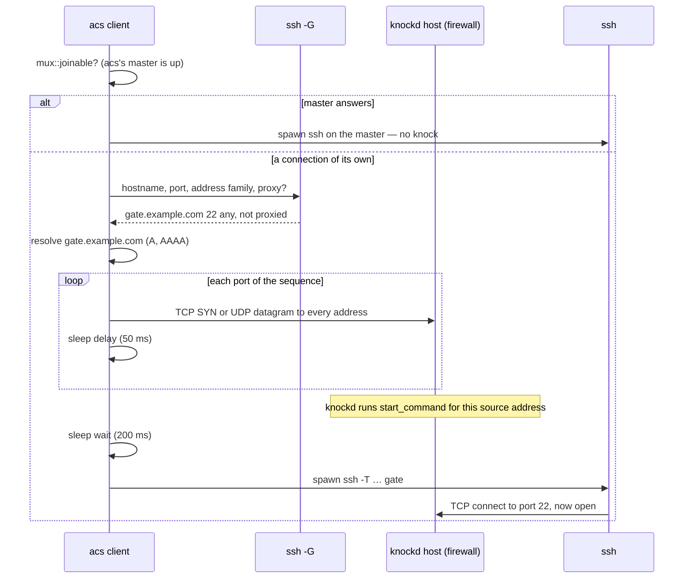

# acs — port knocking

**Status:** In progress — §12 steps 1 (`ssh::Route`) and 2 (`knock.rs`:
parser, sender, reuse table) built; nothing knocks yet, as the dial does not
call it (2026-11-18). Work is the epic acs-8l1v, one bead per step of §12.

Some hosts keep their ssh port closed behind a firewall and open it, for one
source address and usually for a few seconds, only after that address has
"knocked": sent packets to a secret sequence of other ports, in order, within
a time limit. [knockd](https://github.com/jvinet/knock) is the common server
for this. Today acs cannot reach such a host by itself: the ssh dial gets
`Connection timed out` because nothing knocked first. This document is how
acs knocks before it dials, on the first connection, on every redial, and
for every other call that opens a connection of its own.

It extends [DESIGN.md](DESIGN.md) — the dial (§3), ssh options (§7.1), the
configuration (§7.2), host aliases (§7.3), the redial (§5.3) — and changes
none of them except where it says so.

## 1. What exists today

### 1.1 How knockd works

knockd watches an interface with libpcap. It does not listen on the ports it
watches, so to the knocker every knock looks like a packet into a closed or
filtered port. A server entry in `/etc/knockd.conf` looks like this:

```ini
[openSSH]
    sequence      = 7000,8000:udp,9000
    seq_timeout   = 5
    tcpflags      = syn
    start_command = /sbin/iptables -I INPUT -s %IP% -p tcp --dport 22 -j ACCEPT
    cmd_timeout   = 10
    stop_command  = /sbin/iptables -D INPUT -s %IP% -p tcp --dport 22 -j ACCEPT
```

- **The sequence** is a list of ports, each TCP (the default) or UDP. knockd
  tracks progress per **source address**: a hit on the next port advances
  it, and a hit on a port of the sequence out of order starts that address
  over.
- **`seq_timeout`** bounds the whole sequence, first knock to last.
- **`tcpflags`** says which TCP packets count. `syn` is usual; a plain
  `connect()` sends exactly one SYN, which is what the `knock` client does.
- **`start_command`** runs once the sequence completes, with `%IP%` the
  knocker's source address. With **`cmd_timeout`** knockd runs
  `stop_command` that many seconds later; without it, a second sequence
  (often `[closeSSH]`) runs the stop command.
- **An established connection outlives the rule** only because the host's
  firewall also accepts `ESTABLISHED,RELATED` traffic. Every knockd guide
  has that rule; acs depends on it, as every knock client does (§9).
- **One-time sequences** (`one_time_sequences = <file>`) use each sequence
  once and then retire it. acs does not support them (§10).

The `knock` client does what acs must do: a non-blocking TCP `connect()`
closed at once, or one UDP datagram, per port, with an optional delay
between them (`-d`).

### 1.2 What a user can do today, and why it is not enough

Port knocking can already go in front of ssh, in `~/.ssh/config`:

```sshconfig
Host gated
    ProxyCommand sh -c 'knock -d 50 %h 7000 8000:udp 9000 && sleep 0.2 && exec nc %h %p'
```

acs works with that, since everything in the user's ssh config applies to
its dials (DESIGN §3). But it costs more than it should:

- **The dial is now "proxied"** (acs-7sti, DESIGN §12 decision 18), so it
  loses `ConnectTimeout=10`: a redial into a dead network waits out acs's
  30 s redial deadline instead of failing in 10 s.
- **`reachability_tcp` cannot see the host** (DESIGN §7.3): a proxied entry
  falls back to a ping, and a host behind knockd often drops pings too.
- **Every byte of the session goes through `nc`**, an extra process and two
  extra copies on the hot path, for something needed only before the
  connection.
- **It needs `knock` and `nc` installed**, which differ between macOS and
  Linux, and the shell's quoting in an ssh_config line.
- **`-v` says nothing about it**: no knock in the timings, and nothing to
  tell a sequence that did not open the port from a host that is down.

## 2. Goals and non-goals

### Goals

1. **`acs <host>` reaches a knockd host with no tool besides acs and ssh**,
   given the sequence in acs's configuration or on the command line.
2. **Every call that opens a TCP connection knocks first**: the session's
   first connection, every redial, the menu, `acs list`, `acscp`, a command
   run with `acs host -- cmd`. A call that rides on acs's ssh master
   (DESIGN §7.1) opens no connection, so it does not knock.
3. **The knock comes from the address the connection will come from.**
   That is what knockd authorises, so a knock that cannot honour it
   (through a jump host, §5) is refused rather than sent uselessly.
4. **It costs little.** A three-port knock adds about 250 ms to a dial with
   the default timing (§4.3), and nothing to a dial that joins the master.
5. **`-v` accounts for it**: one line per knock, a timing phase, and a hint
   when ssh then cannot connect. It never prints the sequence.
6. **It stays small**: under 10 KB of the x86_64 musl slim build, inside the
   budget of DESIGN §8.1.

### Non-goals

- **Not authentication.** A knock sequence goes in plain text over the
  network and anyone on the path can replay it from the same address. It
  keeps scanners off the ssh port; ssh's own authentication is what
  protects the host. acs treats the sequence as worth not printing, not as
  a secret it guards (§7).
- **No one-time sequences, no Single Packet Authorization** (fwknop), no
  raw packets. Each needs state or privileges acs does not have; §10 says
  how the configuration leaves room for them.
- **No close sequence.** acs does not knock a host shut when a session ends
  (§10, decision 4).
- **No server side.** acs does not configure knockd or the firewall.

## 3. Architecture

The knock is a step of the dial, between the `ssh -G` the dial already runs
(acs-7sti) and spawning ssh. It lives in a new module, `knock.rs`, and is
called from three places:

| Call site | Calls covered |
| --- | --- |
| `client::dial_once` | the first connection, every redial, the session menu (`pick.rs`), `acs list` (`list.rs`), `acscp` (`cp/mod.rs`) |
| `exec::run` | a command with no session named and no terminal, which execs ssh (DESIGN §7.7) |
| `alias::probe_port` | `reachability_tcp`'s connect to the ssh port, while resolving an alias and while a persistent session waits for a lost host (DESIGN §5.3) |



### 3.1 When to knock

**Knock when the call will open a TCP connection to the host, and only
then.** That is decided by the call and by acs's own master, and nothing
else:

- **A redial** never shares a master (DESIGN §3), so it always knocks.
- **A first connection, a side call, a menu, a list of one host** first
  try to join acs's master where it is up (`dial_sharing`, `mux::joinable`).
  The joining attempt does not knock. If it fails and the dial is made
  again on its own connection, that dial knocks.
- **A first connection with no master up** gets `ControlMaster=auto` and
  will start one, so it opens a connection and knocks.
- **`acs list` over every alias** joins a master that is up and otherwise
  dials plainly (acs-hmv); the plain ones knock, each from its own thread,
  as the batch already dials them in parallel.
- **`exec::run`** knocks unless `mux::joinable` says a master is up.

The race is accepted: a master that answers `ssh -O check` and dies before
ssh uses it lets ssh dial on its own without a knock. That dial then times
out like any unknocked one, and `dial_sharing`'s fallback already redials
on a connection of its own, which knocks.

**The user's own `ControlMaster` does not count.** acs cannot tell whether a
master it does not own is up, so a call that may use one (a side call with
`ACS_CONTROL_PERSIST=0`) knocks anyway. An unneeded knock costs only time
(§3.4).

### 3.2 Where to knock: one `ssh -G` per dial

The knock must go to the address ssh will connect to, which is not the
destination as typed: `~/.ssh/config` may give a `HostName`, a `Port` and an
`AddressFamily`, and an alias may have moved the destination since the last
dial (DESIGN §7.3). `ssh -G` with the command line's options answers all of
it, and `Transport::for_dial` already runs it before every session dial to
learn whether the dial is proxied (acs-7sti).

So the two questions become one call. `for_dial` parses `ssh -G` into a
`Route` — `hostname`, `port`, `addressfamily`, and whether a `proxyjump` or
`proxycommand` is set — which `through_proxy` and the knock both read, and
`alias::target` already parses the same lines for `reachability_tcp`. A
call that had no `ssh -G` before (a side call, `exec::run`) runs it only
when a knock is configured, so a host without one pays nothing new.

`ssh -G` failing or taking longer than its 2 s (`PROXY_CHECK`) leaves acs not
knowing where ssh will connect. With a knock configured that fails the dial
with the reason, rather than knocking a guess: `acs: knock: cannot tell
where ssh connects for gated (ssh -G failed)`.

### 3.3 Addresses

The `hostname` is resolved with the system resolver (`netmatch::resolve`,
the lookup `prefer_local_network` uses), bounded by the knock's own deadline
(§4.3). `addressfamily inet` keeps the IPv4 answers, `inet6` the IPv6 ones,
`any` both. ssh may try any of those addresses, and acs cannot know which
will answer first, so **every address is knocked**: knock *i* goes to all of
them before the delay that precedes knock *i + 1*. knockd tracks each source
address apart, so knocking a dual-stack host's v4 and v6 addresses
interleaved is two independent sequences, and a host with one knockd behind
both sees each complete.

The source address is the kernel's choice for each destination, the same
choice it makes for ssh's connect a moment later. acs does not bind a
source. A user whose ssh config sets `BindAddress` or `BindInterface` gets
the knock bound the same way, read from the same `ssh -G`.

### 3.4 Knocking twice

An unneeded knock is harmless to knockd: it runs `start_command` again,
which with `cmd_timeout` schedules its own `stop_command`. A host
configured with open and close sequences and no timeout accumulates one
duplicate firewall rule per knock until the close sequence runs, which is
untidy but not wrong.

The one place acs would knock twice in a row is an alias entry with
`reachability_tcp`, which knocks to probe (§6.1) and is then dialled. A
process-local table remembers the last knock to each address; a dial within
**2 s** of a knock to the same address with the same sequence reuses it and
does not knock again. Two seconds is shorter than any `cmd_timeout` worth
setting, and long enough to cover the probe-then-dial path, which is a few
milliseconds.

## 4. The knock

### 4.1 Sending one knock

- **TCP**: a non-blocking socket, `connect()` to the port, then `close()` at
  once. The kernel sends the SYN inside `connect()`; closing a socket in
  `SYN_SENT` discards it without sending anything else. Closing at once is
  **load-bearing**: a socket left open retransmits its SYN after a second,
  and knockd sees that retransmission as a second hit on a port of the
  sequence, out of order, which starts the attempt over. `EINPROGRESS` is
  success. A `connect()` that completes at once (something does listen
  there) is success too.
- **UDP**: one datagram of zero bytes, sent with `sendto` on a socket
  closed at once. An ICMP port-unreachable that comes back is not read.
- **Errors** that say the packet never left — `ENETUNREACH`, `EHOSTUNREACH`,
  `EADDRNOTAVAIL`, `EAFNOSUPPORT` for an address the machine has no route
  of that family to — drop that address from the knock. If every address
  is dropped, the dial fails as an unreachable host does (§8).

No privileges, no raw sockets, no libpcap: both are ordinary `socket(2)`
calls, available on macOS and Linux to any user.

### 4.2 The sequence

A sequence is written as knockd writes it: ports separated by commas, each
optionally `:tcp` or `:udp`, TCP when neither is given.

```text
7000,8000:udp,9000
```

Spaces around the commas are allowed. A port is 1 to 65535; a sequence has
1 to 32 knocks. A protocol other than `tcp` or `udp` (case-insensitive), a
port out of range or an empty element is an error naming the file and
line, as every configuration error is (DESIGN §7.2). The same port may
appear twice, since knockd allows it.

### 4.3 Timing

Two durations, written as `reachability_timeout` is (`50ms`, `0.2s`, a bare
number of seconds):

| Setting | Default | Range | Meaning |
| --- | --- | --- | --- |
| `delay` | `50ms` | 0 to 5 s | between one knock and the next |
| `wait` | `200ms` | 0 to 10 s | after the last knock, before ssh is spawned |

- **`delay`** keeps knocks in order across a path that may reorder packets.
  knockd needs them in order, and with no delay a burst of three can arrive
  out of order over a busy link or a load-balanced path. 50 ms is far below
  any `seq_timeout` and costs 100 ms for three knocks.
- **`wait`** gives knockd time to see the last knock and run
  `start_command`, usually a fork of `iptables`, tens of milliseconds. Too
  short costs little: ssh's SYN is dropped and the kernel retransmits it a
  second later, by which time the rule is in. 200 ms makes that rare.
- **The whole knock is bounded**: the name's lookup gets the dial's
  `reachability_timeout` (500 ms by default), and the sends themselves take
  microseconds, so a knock's duration is its delays and its wait. acs
  refuses a configuration whose delays add up to more than 15 s, knockd's
  default `seq_timeout`, as it could never complete.
- **A knock is not interruptible**, and needs not be: at its longest it is
  well under the time a command key waits, and the command keys are not
  live until ssh is spawned anyway. A network change during a knock is
  seen by the dial that follows (acs-xo1).

## 5. Through a proxy

knockd authorises the address the knock comes from. Through a `ProxyJump`
or a `ProxyCommand`, ssh's connection to the host comes from the **jump
host**, not from this machine, so a knock sent from here opens the port to
the wrong address.

- **A knock on a proxied dial is refused** unless it names its own `host`
  (§6): `acs: knock: gated is reached through ProxyJump bastion, so a knock
  from here would open it to the wrong address; set knock.host to knock the
  jump host, or knock from the jump host's ProxyCommand`. That is a
  configuration error, raised at the dial and not when the file is read,
  since only `ssh -G` knows whether the dial is proxied.
- **`knock.host` knocks another host instead** — the jump host itself, when
  it is the one behind knockd, or a firewall in front of a NAT'd host. The
  knock then goes to that host's address, resolved as in §3.3, and is sent
  whether or not the dial is proxied: the user has said where it goes.
- **A knock for the far host behind a jump host** is the jump host's job:
  its own `ProxyCommand` can run `knock` there. acs does not run commands on
  the jump host.

The check is the `Route` from §3.2, so it costs nothing extra.

## 6. Configuration

### 6.1 In the configuration file

`knock` is a setting of a **host entry**, and of an **alias** as the
default for its entries — as `identity_file` is (DESIGN §7.2). It is not a
global setting: a sequence belongs to a host, and a global one would knock
every host acs ever dials.

```yaml
aliases:
  gated:
    - host: gated.lan            # at home: no firewall, no knock
    - host: gated.example.com
      knock: 7000,8000:udp,9000  # the short form: a sequence
  lab:
    knock:                       # every lab host knocks the same way
      sequence: 7000, 8000:udp, 9000
      delay: 100ms               # between knocks (default 50ms)
      wait: 500ms                # after the last one (default 200ms)
    hosts:
      - host: lab1.example.com
      - host: lab2.example.com
        knock: none              # this one has no knockd
  behind-bastion:
    - host: inner.internal       # ssh_config: ProxyJump bastion.example.com
      knock:
        sequence: 7000,8000,9000
        host: bastion.example.com # knock the jump host, from here
```

- **Two forms**: a scalar is a sequence with the default timing; a mapping
  has `sequence` (required), `delay`, `wait` and `host`. An unknown key in
  the mapping is an error listing the four.
- **`none`** on an entry drops the alias's knock for that entry. An empty
  value (`knock:`) sets nothing, as everywhere in the file.
- **Precedence**: the command line's `--knock` (§6.2), then the entry's,
  then the alias's. The mapping is replaced whole, never merged key by key:
  an entry's `knock` with its own sequence and no `wait` gets the default
  `wait`, not the alias's. Merging timing across levels would let a
  sequence end up with a wait tuned for another host.
- **Global and local files** merge as for any alias setting (DESIGN §7.2):
  the local file's `knock` replaces the global one's.
- **`reachability_tcp` and a knock**: an entry with both knocks before its
  TCP probe, since without the knock the probe can never connect. That knock
  counts for the dial that follows (§3.4). An entry checked by ping is
  pinged as before. A host behind knockd that also drops ICMP needs
  `reachability_tcp: true` or `reachability_check: false`, which `-v`
  already makes visible ("did not answer").
- **`acs config`** shows an entry's knock as `knock: 3 knocks` in
  `acs config host list`, sets an alias's with
  `acs config host set <alias> knock <spec>` (and `host unset`), and an
  entry's with `acs config host add … --knock <spec>`, writing the scalar
  form when the timing is the default. The sequence itself is shown only by
  `acs config show`, which prints the file.

### 6.2 On the command line

`--knock <spec>` gives a host not in the configuration a knock, or replaces
the configured one for this run; `--knock none` drops it. The spec is the
scalar form of §4.2 with optional timing and target, comma-free so that it
needs no new syntax:

```sh
acs --knock 7000,8000:udp,9000 me@gated.example.com
acs --knock 7000,8000,9000/delay=100ms/wait=0.5s gated
acs --knock 7000,8000,9000/host=bastion.example.com inner
```

It is an acs option, not an ssh one, so it is not passed to ssh (DESIGN
§7.1). `acscp` and `acs list` take it too. `ACS_KNOCK` is the same, for
scripts and tests, with `--knock` winning.

## 7. What acs says

- **Under `-v`**, one line per knock, which names the target and counts the
  knocks but never lists the ports, since `-v` output ends up in bug
  reports and screenshots:
  `acs: knocking gated.example.com (203.0.113.7, 2001:db8::7): 3 knocks,
  50 ms apart, then 200 ms`. A reused knock (§3.4) says so:
  `acs: gated.example.com was knocked 0.1 s ago — not knocking again`.
- **A timing phase**, `knocked`, between `shared ssh master checked` and
  `ssh spawned` (DESIGN §7, `timing::Phase`), so the knock's cost is read off
  the same lines as the rest of the dial. `tests/timing.rs` keeps the list
  and the enum together.
- **When ssh then cannot connect** — it exits 255 with `Connection timed
  out` or `Connection refused` on a dial that knocked — acs adds one line:
  `acs: gated.example.com was knocked before this dial; if it is up, the
  sequence or its timing may not match knockd's (see knockd's log)`. It is
  the question a user would otherwise have no way to ask.
- **Never in an error message** is the sequence printed, nor in `running
  ssh …`, which does not contain it anyway. The configuration file is the
  user's own, and acs does not check its permissions for the knock's sake:
  `/etc/acs/config.yaml` is world-readable by design, and a sequence a
  packet capture reveals is not protected by a file mode (§2).

## 8. Failure

| What happened | First connection | Redial |
| --- | --- | --- |
| `ssh -G` failed or was slow, with a knock configured | exits with the unreachable code and the reason | counts as a failed attempt; the redial waits and tries again (DESIGN §5.3) |
| The knock was refused on a proxied dial (§5) | exits with the error code (1) and the message | the same; a redial does not retry a configuration error |
| The name did not resolve, or no address could be sent to | exits with the unreachable code | a failed attempt, as above |
| Knocked, but ssh cannot connect | as any connect failure, plus the hint of §7 | a failed attempt; the next one knocks again |

A redial knocks on **every** attempt, because the firewall closes again
after `cmd_timeout` and a redial may come minutes after the last knock.
A persistent session waiting for its host (DESIGN §5.3) with
`reachability_tcp` knocks before every probe, every `reachability_interval`
(5 s by default). That is one sequence per probe, which knockd handles and
which is what makes the probe meaningful.

## 9. What the host must have

Nothing acs installs, and nothing beyond a working knockd setup:

- **A rule that keeps established connections**, `-m conntrack --ctstate
  ESTABLISHED,RELATED -j ACCEPT` or its nftables equivalent, ahead of the
  drop. Without it a `cmd_timeout` closes the port under the session, and
  acs's redial then knocks and comes back: the session survives, but it
  reconnects every `cmd_timeout`. `-v` shows that pattern as a redial every
  few seconds, each preceded by a knock.
- **A `seq_timeout` longer than the knock**, which with the defaults is
  `delay × (knocks − 1)`: 100 ms for three.
- **`tcpflags = syn`** or no `tcpflags`. A knockd that wants other flags
  (`fin`, `ack`) needs raw packets, which acs does not send (§2).

## 10. Left out, and what would add it

- **One-time sequences.** knockd retires each sequence after one use, so
  the client must remember which ones it has spent, and two acs processes
  dialling at once must not spend the same one. That is a file with a lock,
  and a redial storm could burn through the list. If it is wanted, the
  mapping form grows a `sequences_file:` key in place of `sequence:`, which
  is why the mapping exists and why `--knock` has a `/key=value` tail.
- **Single Packet Authorization** (fwknop). It authenticates the knock,
  which is the one real weakness of knockd, but needs a key, a client
  protocol and HMAC. It would be another `kind:` of knock in the same place
  in the dial, not a change to it.
- **A close sequence.** Knocking a host shut when a session ends would close
  it for every other acs session and ssh connection from this machine, and
  the next redial would knock it open again. `cmd_timeout` is the server's
  answer and the better one (decision 4).
- **Knocking from the jump host.** acs would have to run a command there
  before the real dial, which is a second ssh connection per dial. The
  jump host's own `ProxyCommand` does it today (§5).

## 11. Implementation

### 11.1 What is new

- **`src/knock.rs`**: `Knock { sequence: Vec<(u16, Proto)>, delay, wait,
  host: Option<String> }`, its parser (`Knock::parse`, used by the
  configuration and by `--knock`), `knock::send(addrs, &Knock)` with the
  socket calls of §4.1, and the 2 s reuse table of §3.4, keyed by address
  and sequence. The socket calls go through a small trait so that the unit
  tests can record what would be sent, and when.
- **`ssh::Route`**: what `ssh -G` says about a dial — `hostname`, `port`,
  `addressfamily`, `bindaddress`, proxied — replacing the boolean
  `through_proxy` and the `alias::target` parser with one parser.
- **`Transport::knock: Option<Knock>`**, set from the resolved alias entry
  and `--knock`, carried into every dial as the identity file is.
- **The dial step**: `client::dial_once` knocks after `for_dial` and before
  `sys::spawn`, when `transport.knock` is set and the call opens its own
  connection (§3.1); `exec::run` does the same before `exec`; and
  `alias::probe_port` before its connect.
- **Configuration**: `knock` in `HOST_KEYS` and in the alias settings,
  parsed by `Knock::parse` with the file and line; `none` handled as for
  `local_forwards`.
- **`acs config`**: the `host set` key, the `host add --knock` flag and
  the `host list` column of §6.1.
- **`--knock` and `ACS_KNOCK`** in `cli.rs`, for `acs`, `acscp` and
  `acs list`.
- **`Phase::Knocked`** in `timing.rs`, and the hint of §7 in the place that
  reports ssh's exit 255.

### 11.2 Testing

- **Unit, `knock.rs`**: the parser (both forms, `:udp`/`:tcp`, spaces,
  every error with its message, the 32-knock and 15 s limits); `send` over
  the recording trait, asserting the order, the interleaving over several
  addresses and the delays within a tolerance; the reuse table, including a
  different sequence to the same address not being reused.
- **Unit, real sockets on loopback**: a TCP listener on each port of a
  sequence and a UDP socket on another: the UDP socket sees exactly one
  empty datagram, and a TCP listener at most one connection, already
  closed. What a TCP listener sees depends on the kernel: Linux completes
  the loopback handshake inside `connect()` (the "something listens there"
  case of §4.1), while macOS leaves the socket in `SYN_SENT` and the close
  discards it before the listener sees anything. Order is asserted through
  the recording trait, not here.
- **Unit, `ssh::Route`**: the `ssh -G` lines for each field and for a
  proxied dial; the refusal of §5 and its message; `knock.host` bypassing
  it.
- **Unit, configuration**: precedence of command line, entry and alias;
  `none`; replacement rather than merge of the mapping; the global and
  local files.
- **Integration, `tests/knock.rs`**, with the `--transport-cmd` test hook
  (DESIGN §9.1) and a fake knockd: a helper that listens on the knock ports
  and only then lets the fake transport answer. Asserts that the first
  connection knocks, that a redial knocks again, that a dial joining acs's
  master does not, and that `-v` and the timings say so without the ports.
- **Linux, `scripts/test_linux.sh`**: a container with real `knockd` and
  `iptables` dropping port 22, needing `CAP_NET_ADMIN` as `tests/netns.rs`
  does. acs connects with the right sequence, fails with the hint of §7 with
  a wrong one, and survives a `cmd_timeout` shorter than the session (§9).
- **Regression guard**: a test asserting a knock socket is closed before
  its retransmission could leave — that `send` returns with no knock
  socket open — since keeping one open is the bug §4.1 calls load-bearing.

### 11.3 Size

`knock.rs` is a few hundred lines of socket calls and parsing, with no
dependency: `libc` is already in. Expected under 10 KB of the slim build,
measured on the x86_64 musl release profile as DESIGN §8.1 measures
everything, and stated in the PR that adds it.

## 12. Implementation plan

1. **`ssh::Route`**: one `ssh -G` parser for the proxy check and
   `reachability_tcp`, with no change in behaviour. Lands alone, as it
   touches the dial path everything shares.
2. **`knock.rs`** with its unit tests: parser, sender, reuse table.
3. **Configuration and `--knock`**: `HOST_KEYS`, alias settings,
   precedence, `ACS_KNOCK`.
4. **The dial**: `dial_once`, `exec::run`, `probe_port`; the proxy refusal;
   `Phase::Knocked`; the `-v` lines and the hint; `tests/knock.rs`.
5. **`acs config`** support.
6. **The Linux check against real knockd**, then README (a "Port knocking"
   section beside the aliases), DESIGN §7.2's example and key list, and this
   document's Status.

## 13. Decisions

| # | Question | Decision |
| --- | --- | --- |
| 1 | Knock in acs, or as a `ProxyCommand` acs installs | **In acs, before ssh is spawned.** A `ProxyCommand` knocks exactly when ssh connects, but makes every dial "proxied" and so loses `ConnectTimeout` (decision 18 of DESIGN), puts a relay on the hot path, and collides with the user's own `ProxyJump`/`ProxyCommand`. The pre-dial knock costs one `ssh -G` the dial already runs |
| 2 | Which calls knock | **Those that open a TCP connection** (§3.1): every redial, and any other call unless acs's own master is up. Knocking on every call would be simpler, and harmless to knockd, but would put the knock's 250 ms back on a reattach the master exists to make fast |
| 3 | A knock through a proxy | **Refused unless `knock.host` names the target** (§5). Sending it anyway would open the firewall to this machine's address, which is no use and hides the misconfiguration behind a connect timeout |
| 4 | A close sequence on exit | **Not supported.** It would close the port for every other session from this machine; `cmd_timeout` closes it without that cost |
| 5 | A global `knock` setting | **No**: a sequence is a host's. Alias-level covers hosts that share one |
| 6 | Default timing | `delay: 50ms`, `wait: 200ms`, both settable per host. Zero delay risks reordering; a longer wait only slows every dial, since a short one costs one SYN retransmission at worst |
| 7 | Printing the sequence | **Never under `-v` or in errors** (§7), only in the configuration itself. It is not a secret acs can keep, but there is no reason to put it in bug reports |
